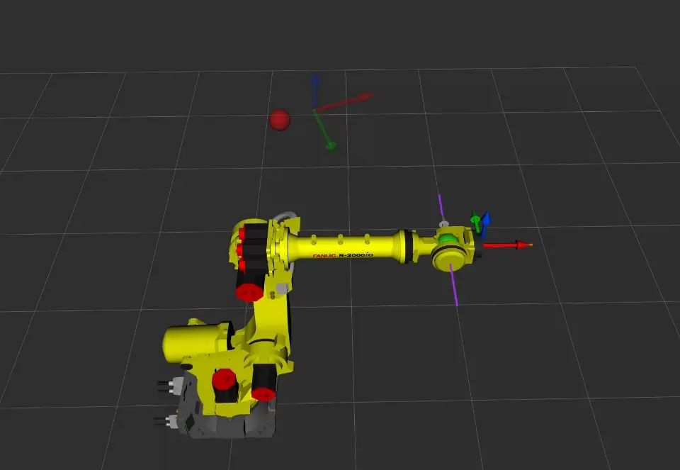
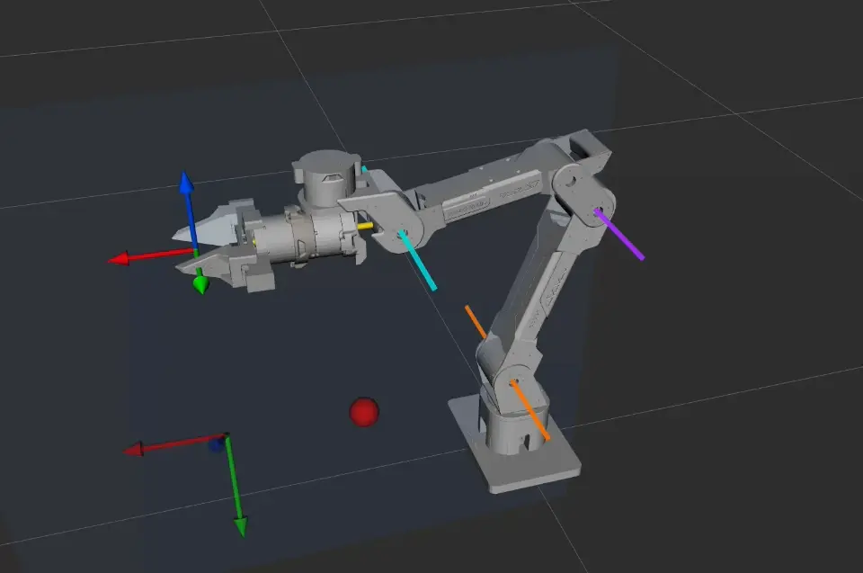

# 第三章 机械臂逆运动学

> 📌 **概述**：逆运动学就是根据末端目标位姿反求出各关节角度。本章先从解的存在性入手，说明机械臂何时有解，为何多解以及如何筛选出真正可用解，再通过两类构型展示解析求解思路，随后介绍不依赖特殊构型的数值迭代法，最后通过末端直线几何路径验证连续逆解与正运动学回代。

## 1 逆运动学解的存在性

正运动学根据已知关节变量计算末端位姿；逆运动学则反过来寻找一组关节变量，使机械臂末端到达给定的目标位姿。

逆运动学方程可能无解，也可能存在一组或多组解。求解时需分别判断目标位置是否可达、目标姿态是否可实现，以及所得关节角能否用于实际运动。

### 1.1 工作空间

机械臂各关节在允许范围内运动时，末端执行器能够到达的全部空间位置称为机械臂的**工作空间**。

人的手臂可以近似说明工作空间：臂长决定最远距离，关节活动范围和身体阻挡则会削去一部分区域。因此，手能够到达的范围是一个并不完整的球体。

机械臂也是如此，其工作空间主要由以下因素决定：

| 影响因素 | 对工作空间的影响 |
|:---:|:---:|
| 连杆长度 | 决定机械臂能够伸到多远 |
| 关节轴线布局 | 决定机械臂能够向哪些方向运动 |
| 关节限位 | 限制各关节能够转动的范围 |
| 机械结构 | 可能因自身干涉而失去部分可达区域 |

目标位姿能够实现，也不代表关节角唯一。同一个末端目标可能对应多种机械臂构型。
### 1.2 逆运动学解的个数

给定一个目标末端位姿，逆运动学方程可能无解、唯一解、多组解，也可能有无穷多解。多组解常来自不同的肩部、肘部和腕部构型。它们的关节角不同，但正运动学结果相同。

同一个末端位姿可以由多组关节角实现，如下：

> 🖼️ **配图占位（同一末端位姿对应的多组关节解）**

> 🧪 **配套演示**：`joyarm_code/chapt/chapt3/chapt3_2r_demo.py` 用平面二连杆直观展示逆解的存在性和多解。拖动目标点可以观察目标不可达、肘上与肘下两组解，以及工作空间边界处两组解重合等现象。

```bash
cd joyarm_code
uv run python chapt/chapt3/chapt3_2r_demo.py
```

### 1.3 数学上有解不等于工程上可用

解析公式或数值迭代得到的关节角，首先只是候选解。即使它能使末端到达目标位姿，也不一定能够直接用于机械臂运动，还需要检查以下条件：

1. **关节限位**：各关节角必须位于机械臂允许的转动范围内；
2. **碰撞约束**：机械臂不能与自身、工作台或周围物体发生碰撞；
3. **奇异性**：应避免机械臂过于接近奇异位形，否则很小的末端运动也可能引起很大的关节运动；
4. **回代误差**：将候选关节角代入正运动学后，得到的末端位姿必须与目标位姿足够接近；
5. **运动连续性**：存在多组可用解时，通常选择距离当前关节角较近的一组，避免机械臂突然切换到另一种构型。

后续解析法负责根据机械臂构型生成多组候选解，数值法通常从给定初值求得一组局部解。无论采用哪种方法，最终结果都需要经过上述检查才能用于轨迹规划和机械臂运动。

## 2 末三轴相交构型的解析解法

JoyArm 的机械结构已确认采用**末三轴相交**的 6R 构型，也称为球形腕。第 4、5、6 关节轴线交于腕心 $W$：后三轴转动会改变末端姿态，却不会改变腕心位置。该结构满足 Pieper 条件，可以把完整逆解拆成位置和姿态两个子问题。

本节先完成球形腕逆解的数学推导，再说明这些公式如何写入 `SphericalWristAnalyticIkineSolver`。求解器内部由 `solve_all()` 组合全部解支，由 `solve()` 结合当前关节角选出一组解。


| 子问题 | 待求量 | 核心思路 |
|:---:|:---:|:---:|
| 位置子问题 | $q_1,q_2,q_3$ | 由目标位姿反推腕心，再由前三轴把腕心移动到目标位置 |
| 姿态子问题 | $q_4,q_5,q_6$ | 消去前三轴姿态后，根据腕部轴线布局分解剩余旋转 |



| 求解阶段 | 哪些关节运动 | 动画中的变化 | 求解结果 |
|:---:|:---:|:---:|:---:|
| ① 定位腕心 | 第 1、2、3 关节 | 绿色腕心逐渐移动到红色目标点 | 完成位置求解 |
| ② 调整姿态 | 第 4、5、6 关节 | 腕心保持重合，实线 RGB 坐标轴逐渐转向半透明目标坐标轴 | 完成姿态求解 |

### 2.1 从目标位姿得到腕心位置

设目标位姿为 ${}^0_6\bm T$，

$$
{}^{0}_{6}\bm T=
\begin{bmatrix}
{}^{0}_{6}\bm R & {}^{0}\bm p_6\\
\bm 0^\mathsf T & 1
\end{bmatrix}
$$

末端坐标系原点到腕心的固定偏置在 $\{6\}$ 中为 ${}^6\bm p_W$，则腕心在基座系中的位置为

$$
{}^0\bm p_W={}^0_6\bm R\,{}^6\bm p_W+{}^0\bm p_6
$$

目标姿态将固定偏置变换到基座系，与目标末端位置相加后即可得到腕心位置。程序先用 _target_link6() 去除 TCP 固定偏置；对于当前解析模型，第 6 系原点就是腕心，因此 T_06[:3, 3] 可直接交给位置子问题。

### 2.2 由腕心求前三个关节角

目标腕心的位置只由前三个关节决定，因此可以先求 $q_1,q_2,q_3$。求解的几何过程通常包含肩部左右和肘部上下两类分支；不同机械臂的连杆尺寸、侧向偏置和零位定义不同，具体公式必须根据实际模型推导。


记 ${}^0\bm p_W=(x_W,y_W,z_W)$。在没有侧向偏置的简化构型中，第一关节角由腕心的水平投影确定：

$$
q_1=\operatorname{atan2}(y_W,x_W)
\quad\text{（另一个候选方向相差 }180^\circ\text{）}
$$

将腕心变换到第 1 坐标系，并扣除肩部固定偏置后，平面内目标坐标记为 $(x,z)$。此时肩部、肘部与腕心形成平面三角形：

$$
\gamma=\frac{x^2+z^2-l_1^2-l_2^2}{2l_1l_2},\qquad
q_3=\pm\arccos(\gamma)
$$

$$
q_2=\operatorname{atan2}(z,x)
-\operatorname{atan2}\!\bigl(l_2\sin q_3,\;l_1+l_2\cos q_3\bigr)
$$

只有 $\gamma\in[-1,1]$ 时才有实数解。若机械臂含有侧向偏置，则仍按腕心位置求解前三轴，但需要使用与实际结构对应的几何关系。_solve_q123() 从 MDH 参数读取侧向偏置、零位偏置和等效连杆长度，并枚举肩部与肘部解支。

### 2.3 消去前三轴并求腕部姿态

前三轴求出后，${}^0_3\bm R$ 已知。目标姿态中由前三轴产生的旋转可以被消去：

$$
{}^3_6\bm R=({}^0_3\bm R)^{\top}{}^0_6\bm R
$$

${}^3_6\bm R$ 只包含后三个关节的旋转，可以根据腕部轴线和坐标系定义求出 $q_4,q_5,q_6$。前三轴负责确定腕心位置，后三轴在腕心不动的条件下完成姿态调整。

对常见的正交球形腕，剩余姿态可写成 ZYZ 欧拉角形式：

$$
{}^3_6\bm R=\bm R_Z(q_4)\bm R_Y(q_5)\bm R_Z(q_6)
$$

设 ${}^3_6\bm R=[r_{ij}]$，一组角度可以由下式提取：

$$
q_5=\operatorname{atan2}\!\bigl(\sqrt{r_{13}^2+r_{23}^2},\,r_{33}\bigr)
$$

$$
q_4=\operatorname{atan2}(r_{23},r_{13}),\qquad
q_6=\operatorname{atan2}(r_{32},-r_{31})
$$

当 $\sin q_5=0$ 时，$q_4$ 与 $q_6$ 只以组合角出现，无法分别确定。此时需要固定其中一个角，再求另一个代表解。_solve_q456() 实现腕部姿态分解；腕部奇异时使用参考角 q0[5] 固定 q6，再反求 q4。

### 2.4 组合、筛选并验证候选解

第一节讲过同一末端目标位姿会产生多组解。肩部、肘部和腕部通常各有两个分支，因此球形腕最多可以产生 $2\times2\times2=8$ 组原始候选。

将前面的数学步骤写成程序后，`solve_all()` 的核心结构如下。代码先求位置解支，再对每一组前三轴解计算剩余姿态，最后求腕部解支：

```python
T_06 = _target_link6(target, T_e6)
raw = []

for q1, q2, q3 in _solve_q123(mdh, T_06[:3, 3]):
    T_03 = np.eye(4)
    for row, qi in zip(mdh[:3], (q1, q2, q3)):
        T_03 = T_03 @ _mdh_transform(row, qi)

    R_36 = T_03[:3, :3].T @ T_06[:3, :3]
    for q4, q5, q6 in _solve_q456(mdh, R_36, q6_ref):
        raw.append(np.array([q1, q2, q3, q4, q5, q6]))
```

这段代码与数学推导一一对应：`_solve_q123()` 实现位置子问题，`R_36` 对应 $({}^0_3\bm R)^\mathsf T{}^0_6\bm R$，`_solve_q456()` 实现姿态子问题。

得到原始候选后，程序用 `_shift_2pi()` 处理相差整数圈的等价角，用 `_fkine_mdh()` 和 `_pose_error()` 完成正运动学回代，并合并重复解。`solve()` 最后保留软限位内、距离参考关节角 $\bm q_0$ 最近的一组。因此，$\bm q_0$ 对解析法的作用是选解参考，而不是迭代起点。

球形腕求解器只有在对应型号的 MDH 参数确定并写入配置后才能启用。求解器还会检查 MDH 结构条件，避免把球形腕公式用于不匹配的模型。

> 📖 **进一步阅读**：若想详细了解球形腕解析解的完整实现，请阅读 `joyarm_code/joyarm_core/robotics/ikine/ikine_solver_analytic_spherical_wrist.py`。

## 3 连续三轴平行构型的解析解法

Pieper 条件不限于末三轴相交。连续三个关节轴相互平行时，也可以利用特殊几何关系构造解析解。但该构型解耦顺序与球形腕不同。

本节公式对应 `ParallelAxisAnalyticIkineSolver`。当前 `rebot_arm_b601_dm` 型号配置启用了该求解器，用于保留和验证连续三轴平行构型的解析实现。

### 3.1 构型特征与解耦思想

当 $q_1$ 固定时，第2、3、4关节带动机械臂在同一个平面内运动。它们既能改变机械臂的弯曲形状，也会共同改变末段连杆在平面内的朝向。

对于本节采用的轴线方向，三个关节对末段朝向的共同作用可以合并为一个角：

$$
\phi=-q_2+q_3+q_4
$$

式中的正负号取决于各关节轴的方向和坐标系定义，换一台机械臂后不一定相同。

$\phi$ 表示末段连杆在运动平面内的合成朝向，但它不能单独确定腕部参考点的位置。即使 $\phi$ 相同，不同的 $q_2,q_3,q_4$ 组合仍然可以形成不同的臂形，使腕部参考点落在不同位置。$\phi$ 已知后，我们只能确定末段连杆在目标位置中占据的方向和投影；扣除这部分投影，剩余位置才能化为平面 2R 问题。

> 📌 **求解顺序提示**：先由目标腕部位置确定 $q_1$，再由目标姿态解出合角 $\phi$ 与腕角 $q_5,q_6$，最后利用目标位置和已知的 $\phi$ 反推 $q_2,q_3,q_4$。这与球形腕“前三轴定位腕心、后三轴调整姿态”的解耦方式不同。



| 求解阶段 | 动画中的变化 | 求解结果 |
|:---:|:---:|:---:|
| ① 求 $q_1$：腕部参考点的水平投影 | 根据目标腕部位置求解 $q_1$，第 1 关节带动蓝色运动平面转向目标方位 | 目标腕部位置进入第 2、3、4 关节的运动平面 |
| ② 姿态子问题：先解出 $\phi,q_5,q_6$ | 根据目标姿态求解 $\phi,q_5,q_6$，实线 RGB 坐标轴逐渐与半透明目标坐标轴重合 | 末端姿态与目标一致，但绿色腕部参考点尚未到达红色目标点 |
| ③ 位置子问题：由 $\phi$ 解出 $q_2,q_3,q_4$ | 保持 $\phi,q_5,q_6$ 不变，联动 $q_2,q_3,q_4$，使绿色腕部参考点逐渐移动到红色目标点 | 在保持末端姿态不变的同时完成腕部位置求解 |

### 3.2 求 $q_1$：腕部参考点的水平投影

解析求解前，先根据机械臂的固定几何关系，将目标末端位姿转换为腕部参考点 $O_5$ 的目标位置，记为：

$$
{}^0\bm p_{O_5}
=
\begin{bmatrix}
x_5\\
y_5\\
z_5
\end{bmatrix}
$$
第 1 关节转动时，会带动第 2、3、4 关节所在的运动平面绕基座轴旋转。从基座上方观察，$O_5$ 在水平面内的投影方向，就是该运动平面需要转向的方向。

因此，第 1 关节角为


$$
q_1=\operatorname{atan2}(y_5,x_5)
$$

其中，$\operatorname{atan2}(y_5,x_5)$ 根据水平投影的两个坐标同时判断象限，得到腕部参考点相对于基座 $x$ 轴的方位角。

求出 $q_1$ 后，第 2、3、4 关节的运动平面便转向目标腕部位置。程序先用 _target_link6() 去除 TCP 固定偏置，再由 _solve_q1() 纳入侧向偏置和关节零位，枚举运动平面的候选方向。

### 3.3 姿态子问题：先解出 $\phi,q_5,q_6$

第 2、3、4 轴都会改变末段朝向，但只根据目标姿态，还不能确定三个关节各自的转角。求解时先把它们对姿态的共同作用合并为平面朝向角 $\phi$：

$$
\phi=-q_2+q_3+q_4
$$

这样一来，姿态子问题中只剩三个待求量：$\phi$、$q_5$ 和 $q_6$。先从目标姿态求出这三个量，下一节再结合目标位置，把 $\phi$ 分解为具体的 $q_2,q_3,q_4$。

具体做法是先去掉已经求出的第 1 轴转动和基座固定扭转。设目标末端姿态为 ${}^0_6\bm R$，把这两部分合记为

$$
\bm B=\bm R_Z(q_1)\bm R_X(-\tfrac{\pi}{2})
$$

则约化后的姿态为 $\bm Q=\bm B^{\top}{}^0_6\bm R$。此时 $\bm Q$ 只包含“平面合角 + 后两轴”的旋转：

$$
\bm Q=
\underbrace{\bm R_Z(\phi)}_{\text{第 2～4 轴的合成朝向}}
\bm R_X(\alpha_4)
\underbrace{\bm R_Z(q_5)}_{\text{第 5 轴}}
\bm R_X(\alpha_5)
\underbrace{\bm R_Z(q_6)}_{\text{第 6 轴}}
$$

主要思路：**先不区分 $q_2,q_3,q_4$，而把它们对姿态的作用压缩成一个 $\phi$**。

当 $\alpha_5=\pi/2$ 且 $\sin\alpha_4\ne0$ 时，可从约化姿态矩阵 $\bm Q$ 中依次求出 $q_5$、$\phi$ 和 $q_6$。先由 $\bm Q$ 的 $(2,2)$ 元素求 $q_5$：

$$
\cos q_5=-\frac{Q_{22}}{\sin\alpha_4},\qquad
q_5=\operatorname{atan2}\!\bigl(\pm\sqrt{1-\cos^2q_5},\;\cos q_5\bigr)
$$

正负号给出两组腕部翻转分支。选定一组 $q_5$ 后，再依次求 $\phi$ 和 $q_6$：

$$
\phi=\operatorname{atan2}(Q_{12},Q_{02})
-\operatorname{atan2}\!\bigl(-\cos\alpha_4\cos q_5,\;\sin q_5\bigr)
$$

$$
q_6=\operatorname{atan2}(R_{10},R_{00})
$$

其中 $\bm R=\bigl[\bm R_Z(\phi)\bm R_X(\alpha_4)\bm R_Z(q_5)\bm R_X(\alpha_5)\bigr]^{\top}\bm Q$，也就是从 $\bm Q$ 中继续去掉已经求出的 $\phi$ 和 $q_5$，剩下的旋转用于求 $q_6$。

当 $|\sin q_5|\to0$，即 $q_5=0$ 或 $180°$ 时，$\phi$ 与 $q_6$ 只以组合角 $(\phi\pm q_6)$ 出现，无法单独确定。此时可以固定 $q_6$ 的参考值，再由组合角反求 $\phi$，从无穷多组等价角度中选取一个代表解。_reduced_orientation() 负责消去已知旋转，_solve_phi_q56() 负责提取合角与腕角，并保留腕部翻转分支。

> 📌 **要点**：这是三轴平行构型与球形腕最大的不同——**姿态方程顺带解出了位置子问题所需的 $\phi$**，而不是"位置定腕心 → 姿态定腕角"。

### 3.4 位置子问题：由 $\phi$ 解出 $q_2,q_3,q_4$

求出 $q_1$ 后，第 2、3、4 轴的运动可以看成一个平面问题。把腕部参考点 $O_5$ 变换到这个平面内：

$$
{}^1\bm p_{O_5}={}^0_1\bm R^{\top}\bigl({}^0\bm p_{O_5}-{}^0\bm p_1\bigr)
$$

在本节的简化几何中，$O_5$ 在第 1 系中的平面坐标记为

$$
x={}^1 p_{O_5,x},\qquad z={}^1 p_{O_5,z}
$$

将两段等效连杆的长度记为 $l_1,l_2$，对应的关节角记为 $q_2,q_3$。在本节的简化几何中，肩部、肘部和腕部参考点 $O_5$ 构成一个三角形，因此可由余弦定理先求 $q_3$：

> 🖼️ **配图占位（图 3-4：连续三轴平行构型的位置子问题）**：在运动平面内标出肩部、肘部、腕部参考点、两段等效连杆长度以及目标坐标 $(x,z)$，对应余弦定理和 $q_2,q_3,q_4$ 的求解关系。

$$
\cos q_3=\frac{x^2+z^2-l_1^2-l_2^2}{2l_1l_2}
$$

反余弦给出的正负两组结果对应肘上和肘下两种构型。选定 $q_3$ 后，再根据目标点的方向求肩关节 $q_2$：

$$
q_2=
\underbrace{\operatorname{atan2}(z,x)}_{\text{目标点的方向}}
-\underbrace{\operatorname{atan2}\!\bigl(l_2\sin q_3,\;l_1+l_2\cos q_3\bigr)}_{\text{连杆弯曲带来的修正角}}
$$

此时 $q_2,q_3$ 已经使腕部参考点到达目标位置，但末段朝向还不一定等于 3.3 节求出的 $\phi$。最后用 $q_4$ 补足剩余角度：

$$
q_4=\phi+q_2-q_3
$$

总结：用三角形确定 $q_2,q_3$，再用 $q_4$ 补足末段朝向。`_solve_q234()` 实现这一平面几何计算。

把三部分数学关系组合起来，`solve_all()` 的核心流程如下：

```python
T_06 = _target_link6(target, T_e6)
raw = []

for q1 in _solve_q1(mdh, T_06[:3, 3]):
    Q = _reduced_orientation(mdh, T_06[:3, :3], q1)

    for phi, q5, q6 in _solve_phi_q56(mdh, Q, q6_ref=q6_ref):
        q234 = _solve_q234(mdh, T_06[:3, 3], q1, phi)
        for q2, q3, q4 in q234:
            raw.append(np.array([q1, q2, q3, q4, q5, q6]))
```

程序的嵌套顺序就是解析法的求解顺序：先确定运动平面，再求合角与腕角，最后求平面内的具体臂形。原始候选同样需要经过等价角处理、正运动学回代和去重；`solve()` 再从软限位内选择距离 $\bm q_0$ 最近的一组。

两种解析求解器的数学分解不同，但程序结构相同：`solve_all()` 生成并验证候选解，`solve()` 结合当前关节角选择一组可用解。

> 🧪 **配套演示**：`joyarm_code/chapt/chapt3/chapt3_ikine_demo.py` 使用本节的三轴平行解析求解器枚举同一目标位姿的候选解，逐组进行正运动学回代，并在 MeshCat 中播放不同机械臂构型。绿色表示限位内解，红色表示超出硬限位的几何解。

```bash
cd joyarm_code
uv run python chapt/chapt3/chapt3_ikine_demo.py
```

只查看求解结果、不启动 MeshCat 时，可以运行：

```bash
uv run python chapt/chapt3/chapt3_ikine_demo.py --headless
```

> 📖 **进一步阅读**：若想详细了解连续三轴平行构型解析解的完整实现，请阅读 `joyarm_code/joyarm_core/robotics/ikine/ikine_solver_analytic_parallel.py`。

## 4 机械臂逆运动学的数值解法

第 2、3 节介绍的解析解依赖特定构型。对于没有闭式解的机械臂，也可以从一组初始关节角出发，不断修正关节角，使末端逐步靠近目标位姿。这就是数值逆运动学。本节对应 `PinIkineSolver`：Pinocchio 负责计算正运动学和雅可比，求解器负责位姿误差、阻尼更新、限位处理与多起点重试。

### 4.1 数值逆解在做什么

数值逆解没有一步到位的公式，而是反复执行下面四步：

1. 给定一组初始关节角 $\bm q_0$；
2. 用正运动学计算当前末端位姿；
3. 比较当前位姿与目标位姿，得到误差；
4. 根据误差计算关节修正量，更新关节角。

更新后的关节角会再次进入正运动学。如果误差已经足够小，就返回当前结果；否则继续迭代。

数值逆解就是先给出一组关节角，再根据末端偏差反复修正。`solve()` 准备目标帧、软限位和起点，`_lm()` 完成单个起点的迭代；初值失败时再尝试其他起点。

### 4.2 如何表示位姿误差

末端位姿同时包含位置和姿态。位置可以直接相减：

$$
\bm e_p(\bm q)=\bm p_{\mathrm d}-\bm p(\bm q)
$$

姿态不能直接用两个旋转矩阵相减。这里用“从当前姿态转到目标姿态所需的最小旋转”表示姿态误差：

$$
\bm e_R(\bm q)
=
\log_3\!\bigl(\bm R_{\mathrm d}\bm R(\bm q)^{\top}\bigr)
$$

$\log_3$ 把两个姿态之间的相对旋转变成三维旋转向量。将位置误差和姿态误差合在一起，得到六维误差：

$$
\bm e(\bm q)=
\begin{bmatrix}
\bm e_p(\bm q)\\
\bm e_R(\bm q)
\end{bmatrix}
$$

求解器用下面的残差判断是否收敛：

$$
\varepsilon(\bm q)
=
\|\bm e_p(\bm q)\|_2
+
\|\bm e_R(\bm q)\|_2
$$

当 $\varepsilon(\bm q)<\mathrm{tol}$ 时，就认为当前关节角已经满足目标位姿。`_err()` 实现这一残差，最终值由 `IKResult.err` 返回。

### 4.3 如何修正关节角

雅可比矩阵 $\bm J$ 描述关节角微小变化与末端位姿变化之间的关系。利用这一关系，可以根据末端误差计算关节修正量 $\Delta\bm q$。为避免奇异位形附近的关节修正量过大，求解器采用阻尼伪逆提高迭代稳定性。

关节修正量可以写成

$$
\Delta\bm q=\bm J_{\lambda}^{+}\bm e
$$

一种常用的阻尼伪逆形式为

$$
\bm J_{\lambda}^{+}
=\bm J^T
\left(\bm J\bm J^T+\lambda^2\bm I\right)^{-1}
$$

普通伪逆在奇异位形附近可能产生很大的关节修正量；阻尼参数 $\lambda$ 用来压小这些不稳定的修正。$\lambda$ 较小时，求解器更积极地靠近目标；$\lambda$ 较大时，关节修正更保守，但末端误差也可能增大。

Levenberg–Marquardt（LM）方法会根据本次修正是否让误差下降，自动调整 $\lambda$。阻尼伪逆只能缓和数值放大，不能消除机械臂几何结构本身的奇异性。

得到修正量后，更新关节角并限制在关节范围内：

$$
\bm q_{k+1}
=
\operatorname{clip}\!\bigl(
\bm q_k+\Delta\bm q_k
\bigr)
$$

上述公式在 `_lm()` 中写成下面的迭代核心。这里省略了循环外的模型、目标帧和参数准备：

```python
pin.forwardKinematics(model, data, q)
M = pin.updateFramePlacement(model, data, fid)

e = np.hstack([
    p_ref - M.translation,
    pin.log3(R_ref @ M.rotation.T),
])

J = pin.computeFrameJacobian(
    model, data, q, fid, pin.LOCAL_WORLD_ALIGNED
)
U, sv, Vt = np.linalg.svd(J, full_matrices=False)

dq = (Vt.T * (sv / (sv**2 + lam**2))) @ U.T @ e
q_new = np.clip(q + dq, limits.q_min, limits.q_max)
```

代码中的 `e` 对应六维位姿误差 $\bm e$，`J` 对应 $\bm J$，`dq` 对应 $\Delta\bm q$。实际求解器还会限制 $\Delta\bm q$ 的长度，并比较 `q_new` 是否让残差下降：下降时接受本步并减小阻尼，上升时拒绝本步并增大阻尼。雅可比的几何含义和奇异性将在[第四章](chapt4_jacobian.md)中展开。

### 4.4 初值与奇异

数值解依赖初值 $\bm q_0$。初值靠近目标解时，通常只需少量迭代；初值较远时，求解可能变慢、落入另一组解，或者无法收敛。

奇异位形附近，某些方向上的末端运动需要很大的关节变化。阻尼可以减轻修正量突然放大的问题，但不能保证每次都成功。求解过程中还需要限制单步修正量，并把关节角限制在软限位内。

完整的 `solve()` 会依次尝试初值和软限位内的其他起点。任一起点收敛便返回成功；全部失败时仍返回尝试过程中残差最小的关节角，并将 `success` 设为 `False`。固定随机种子使相同输入的重试过程可以复现。

> 📖 **进一步阅读**：若想详细了解 Pinocchio 数值逆解的完整实现，请阅读 `joyarm_code/joyarm_core/robotics/ikine/ikine_solver_pin.py`。

## 5 本章实践：笛卡尔直线路径的连续逆解

参考代码位于 `joyarm_code/chapt/chapt3/chapt3_movel_demo.py`。本节把第二章的位姿表示、正运动学与本章逆运动学连接起来，重点验证笛卡尔几何路径能否转换为连续、可回代的关节路径。脚本文件名为兼容已有运行命令而保留，其中的路径不包含速度、加速度和到达时间规划，不等同于完整的 `MoveL`。

> 📖 **章节边界**：本章解决“路径上的每个末端位姿对应哪些关节角”，即几何路径与连续逆解；[第五章](chapt5_trajectory.md)进一步为路径建立时间规律，生成参考位置、速度和加速度。完整 `MoveL` 需要同时具备笛卡尔路径、时间参数化、连续逆解和控制执行。

### 5.1 任务目标

机械臂从 home 位形出发，保持末端姿态不变，在基座坐标系 $Z$ 轴正方向生成一段长度为 $3\ \mathrm{cm}$ 的末端直线几何路径。

设路径参数 $s\in[0,1]$，起点和终点位置分别为 $\bm p_0$、$\bm p_1$，则目标位置为

$$
\bm p(s)=(1-s)\bm p_0+s\bm p_1
$$

本例姿态保持不变，因此每个路径点的目标姿态都等于起点姿态。

### 5.2 从直线路径得到连续关节解

程序先用正运动学计算 home 位形的末端位姿，再生成 31 个等距目标位姿。对每个目标位姿调用一次逆运动学，并把上一点的结果作为下一点的参考关节角：

~~~python
q_path = [q_start]

for pose in target_poses[1:]:
    result = arm.solve_ikine(pose, q0=q_path[-1])
    if not result.success:
        return
    q_path.append(result.q)
~~~

解析法会选择距离上一点最近的候选解，数值法也会从上一点附近开始迭代，因此相邻路径点更容易保持在同一解支上。

求出整条路径后，程序统一检查：

| 检查项 | 目的 |
|:---:|:---:|
| 每一点逆解均成功 | 防止执行未完成的路径 |
| 所有关节角位于软限位内 | 保持在推荐工作范围 |
| 相邻关节角没有突跳 | 防止逆解切换到另一解支 |
| 正运动学回代误差满足阈值 | 确认关节路径对应目标直线 |

只有全部检查通过，程序才允许启动真机运动。

### 5.3 真机执行

执行真机前，可以先在 MeshCat 中检查同一条几何路径及其连续逆解：

```bash
cd joyarm_code
uv sync
uv run python chapt/chapt3/chapt3_movel_demo.py rebot_arm_b601_dm --simulate
```

仿真中的黄色线表示末端目标直线，绿色点和红色点分别表示起点与终点，白色坐标系表示当前 TCP。确认路径方向和机械臂构型符合预期后，再运行真机示例：

~~~bash
cd joyarm_code
uv run python chapt/chapt3/chapt3_movel_demo.py rebot_arm_b601_dm
~~~

脚本包含两次确认。第一次确认后，运动状态机使机械臂回到 home；第二次确认后，脚本依次下发预先求得的关节路径点。运动状态机和关节指令接口是代码库已经提供的真机运行能力，本章只使用这些接口，不展开其内部轨迹规划和控制原理。

运行时观察以下现象：

1. 终端先打印路径点数量、最大关节跳变和正运动学回代误差；
2. 机械臂回到 home 后，末端沿基座 $Z$ 轴正方向移动约 $3\ \mathrm{cm}$；
3. 末端姿态在运动过程中保持不变；
4. 程序结束时，机械臂经状态机回零并失能。

本章实践的完整流程为

$$
\text{末端直线路径}
\longrightarrow
\text{逐点逆运动学}
\longrightarrow
\text{连续关节路径}
\longrightarrow
\text{回代验证与离散执行}
$$

离散执行只用于观察连续逆解产生的实际运动，不分析速度、加速度和轨迹平滑性；这些内容由第五章继续展开。
