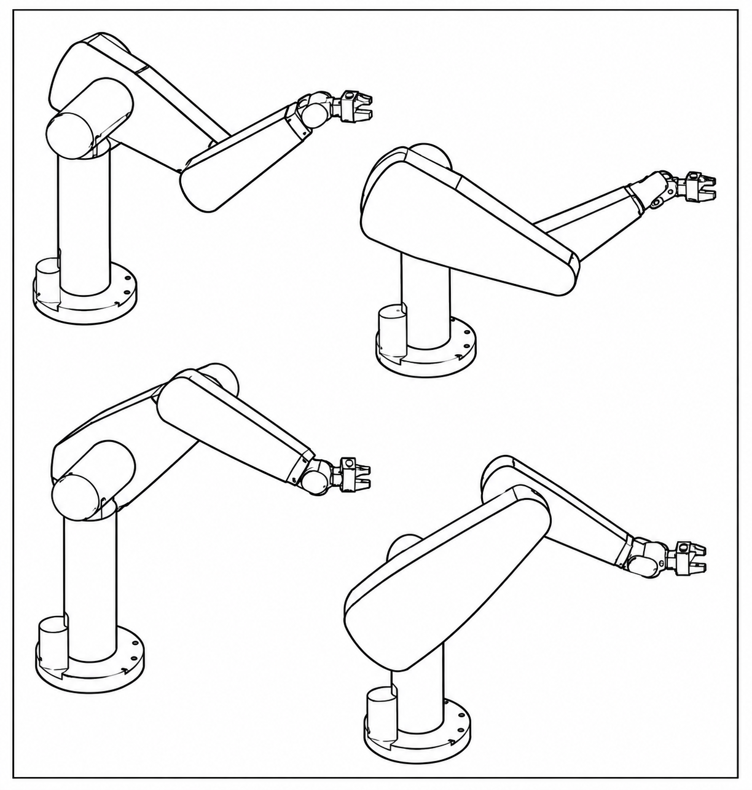
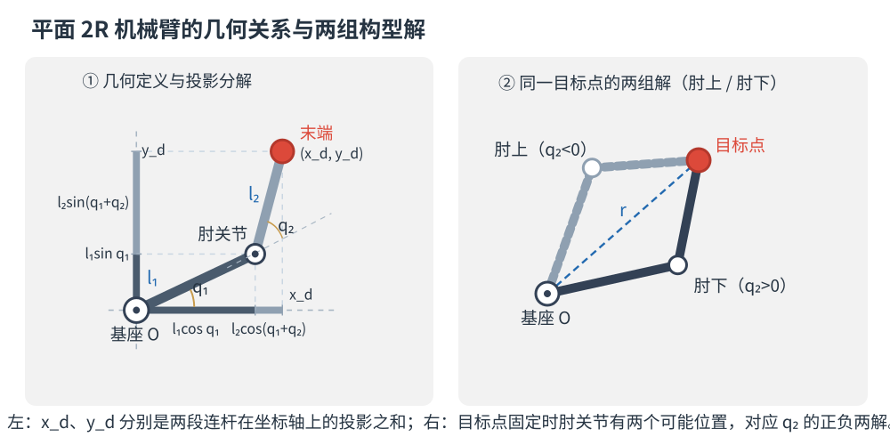
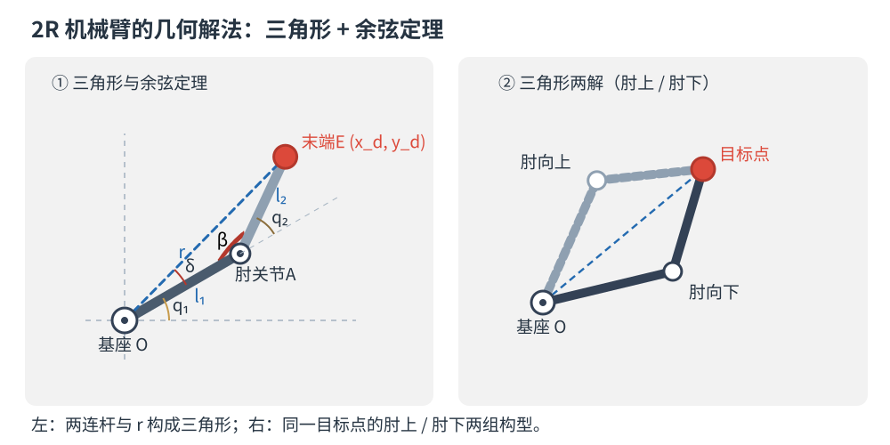
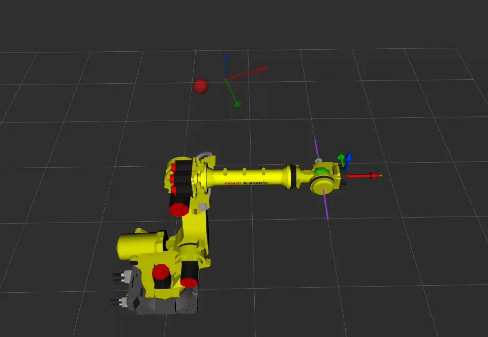
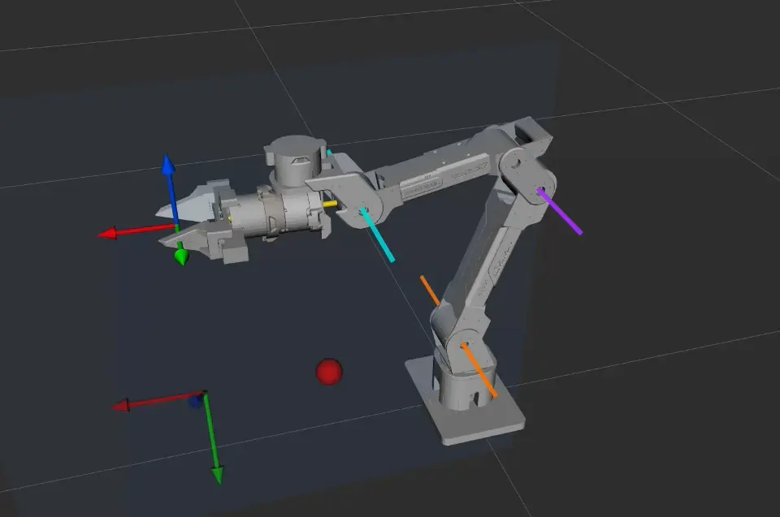
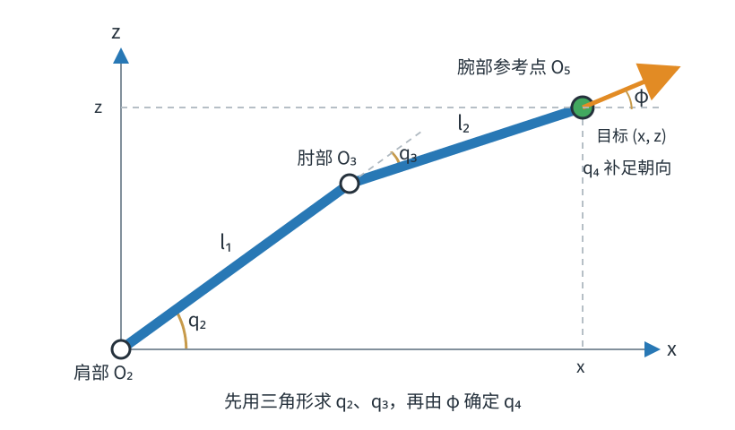

# 第三章 位置逆运动学

> 📌 **概述**：本章研究由末端目标位姿反求关节角的问题。先用平面 2R 机械臂说明可达性和多解，再介绍 JoyArm 的解析解与通用数值解，最后通过正运动学回代验证结果。


## 1 位置逆运动学的可解性


正运动学根据已知关节变量计算末端位姿；逆运动学则根据给定的末端位置或位姿，反求机械臂的关节变量。逆运动学求解前，首先需要判断目标是否可达；只有目标位于机械臂的工作空间内，逆解才可能存在。


> 📌 **记号约定**：本章记 $\mathcal{Q}$ 为**关节空间**，即关节变量 $\bm q$ 的允许取值范围；$\mathbb{R}^3$ 为**三维实数空间**，即所有形如 $(x,y,z)$ 的位置坐标构成的集合；$\mathcal{W}_{\mathrm{R}}$、$\mathcal{W}_{\mathrm{D}}$ 分别表示可达、灵巧工作空间。其余记号沿用[第二章](chapt2_fkine.md)。

### 1.1 工作空间与可达点


机械臂末端执行器在关节运动范围内能够到达的全部空间位置，称为**可达工作空间**（reachable workspace）。

例如，对于两连杆平面 $2R$ 机械臂，连杆长度分别为 $l_1$ 和 $l_2$，末端到基座原点的距离记为：

$$
r=\sqrt{x_{\mathrm d}^2+y_{\mathrm d}^2}
$$

在不考虑关节限位时，目标点可达的条件为：

$$
|l_1-l_2|\leq r\leq l_1+l_2
$$

这说明末端只能到达一个环形区域：距离过远时，两根连杆无法伸到目标点；距离过近时，连杆即使完全折叠也无法到达目标点。

同时需要注意：目标位置可达，不代表任意姿态都可达，能够以任意姿态到达的位置叫作灵巧工作空间，他通常小于可达工作空间。本章只需要知道这一差别，不展开计算。

### 1.2 逆运动学解的个数

目标可达不代表关节角唯一，机械臂可能以不同的肩部、肘部、腕部姿态达到同一个末端目标。满足目标位姿的全部关节角可以写成一个解集，如下：

$$
\mathcal{Q}_{\mathrm d}
=
\left\{
\bm q\in\mathcal Q
\mid
f(\bm q)={}^0_e\bm T_{\mathrm d}
\right\}
$$

这个集合可能为空、只包含一组解，也可能包含多组解。多解主要由机械臂的构型、关节周期性和冗余自由度共同产生。比如说肘部可以采用肘上或肘下构型，腕部也可能出现翻转前后的两组姿态。

以经典的 PUMA 560 为例，同一个末端位姿可以由多组关节角实现：



当目标靠近工作空间边界或奇异位形时，有些解会重合或消失；再加上关节限位，一些数学上成立的解也会被排除。所以，程序不光要算出候选解，还得从中挑出一组真正适合运动的解，一般会优先选离当前关节角近、不超限位、又远离奇异位形的那些。

---

## 2 位置逆运动学的代数解法和几何解法

逆运动学就是已知末端目标，反推关节角。如果目标只有末端位置，叫位置逆运动学；位置和姿态都要管，叫完整位姿逆运动学。只约束位置，可选的关节姿态一般更多；但装配、拧螺丝这类任务，末端朝向也得满足要求。

按求解手段，逆解方法分两大类：**解析法**给出关节角的闭式表达式，**数值法**通过迭代逼近（见[第 5 节](#5)）。本节面向低自由度机械臂，讲清解析法最基础的两条思路——**代数法**与**几何法**。


### 2.1 代数解法

把正运动学方程 $f(\bm q)={}^0_e\bm T_{\mathrm d}$ 展开为标量方程组，利用三角函数恒等式与消元法，逐个解出关节角。

#### 2.1.1 平面 2R 机械臂的代数求解

**问题**：2R 臂连杆长 $l_1,l_2$，关节角 $q_1,q_2$，求末端到达目标点 $\bm p_{\mathrm d}=(x_{\mathrm d},y_{\mathrm d})$ 所需的 $q_1,q_2$。分三步：写出正运动学方程 → **消元**解出 $q_2$ → 回代解出 $q_1$。

**第一步：写出正运动学方程**

如图，末端位置等于两段连杆位移之和——$q_2$ 是相对前一根连杆的**相对转角**，故第二段连杆的方向角为 $q_1+q_2$：



$$
\begin{cases}
x_{\mathrm d}=l_1\cos q_1+l_2\cos(q_1+q_2)\\[4pt]
y_{\mathrm d}=l_1\sin q_1+l_2\sin(q_1+q_2)
\end{cases}
\tag{1}
$$

这是**两个方程、两个未知数**的方程组，但正弦、余弦相互耦合，无法直接消元。$q_2$ 只出现在 $\cos(q_1+q_2)$ 与 $\sin(q_1+q_2)$ 里，若能设法把 $q_1$ "剥离"出去，就只剩含 $q_2$ 的一元方程。

**第二步：两式平方相加，消去 $q_1$ 解出 $q_2$**

将两式各自平方后相加，交叉项消去未知角，可得：

$$
r^2=x_{\mathrm d}^2+y_{\mathrm d}^2=l_1^2+l_2^2+2l_1l_2\cos q_2
$$

于是：

$$
\cos q_2=\frac{r^2-l_1^2-l_2^2}{2l_1l_2}
\quad\Longrightarrow\quad
q_2=\pm\arccos\!\left(\frac{r^2-l_1^2-l_2^2}{2l_1l_2}\right)
\tag{2}
$$

这也可以从**基座、肘关节、末端三点构成的三角形**中，用余弦定理直接得到。正、负号分别对应**肘部向下**与**肘部向上**两组构型（见上图右侧）；当 $r=l_1+l_2$ 或 $r=|l_1-l_2|$ 时两解重合，即为奇异位形。

**第三步：回代解出 $q_1$**

$q_2$ 已知后，$\cos q_2$、$\sin q_2$ 即为常数。用和角公式展开式（1），并按 $\cos q_1$、$\sin q_1$ 整理，得到二元线性方程组：

$$
\cos q_1=\frac{(l_1+l_2\cos q_2)x_{\mathrm d}+(l_2\sin q_2)y_{\mathrm d}}{D},\qquad
\sin q_1=\frac{(l_1+l_2\cos q_2)y_{\mathrm d}-(l_2\sin q_2)x_{\mathrm d}}{D}
$$

其中 $D=l_1^2+l_2^2+2l_1l_2\cos q_2=r^2$。由 $\tan q_1=\sin q_1/\cos q_1$，把两者当作"纵坐标"与"横坐标"送入 $\operatorname{atan2}$ 以还原象限，即得"方位角 + 构型修正角"形式：

$$
q_1=\operatorname{atan2}(y_{\mathrm d},x_{\mathrm d})-\operatorname{atan2}\!\bigl(l_2\sin q_2,\;l_1+l_2\cos q_2\bigr)
\tag{3}
$$

其中第一项是目标点相对基座的方位角，第二项由肘部构型（$q_2$ 的正负）决定。把 (2) 的两组 $q_2$ 分别代入 (3)，即得两组解析解。

> 💡 **关键技巧**：用"两式平方相加"消去某个未知量（如本例消去 $q_1$），或把 $\sin q_i,\cos q_i$ 当作未知数解出三角函数值；反解角度务必用 $\operatorname{atan2}$ 而非 $\arctan$（后者会丢象限、漏解）。


**2R 方程少、耦合弱，故可逐次消元得闭式解；通用 6R 六个关节高度耦合，消元后为高阶多项式，通常无闭式解，只有末三轴相交或连续三轴平行等特殊构型能化简，其余只能数值迭代求解。**

### 2.2 几何解法

同一个平面2R问题也可以从几何关系出发求解。

$$
r=\sqrt{x_{\mathrm d}^{2}+y_{\mathrm d}^{2}}
$$

对这个三角形使用余弦定理，就能得到与式（2）相同的肘关节角 $q_2$。正、负两支分别对应肘上和肘下两种构型。



目标点相对基座的方位角为

$$
\beta=\operatorname{atan2}(y_{\mathrm d},x_{\mathrm d})
$$

设第一根连杆与目标方向之间的夹角为 $\delta$，则第一关节角为

$$
q_1=\beta\mp\delta
$$

  $q_1$ 和 $q_2$ 的符号需要根据肘上、肘下分支选择。据此得到的两组关节角，与代数法的结果完全一致。

代数法从运动学方程出发，步骤容易转化为程序，但方程复杂时推导会迅速膨胀；几何法更直观，却依赖清晰的轴线和投影关系。实际推导中通常会混合使用两种方法：先根据机械臂构型把问题化成平面几何，再用代数公式计算各个解支。

对应的交互演示位于 `joyarm_code/chapt/chapt3_2r_demo.py`。移动目标点可以观察肘上、肘下、边界两解重合以及目标不可达等情况。

## 3 末三轴相交的 6R 机械臂：Pieper 解耦解法

第 2 节指出：通用 6R 的逆解方程组高度耦合，通常无封闭解；但当构型满足特定几何条件时，方程可以**解耦**从而得到闭式解。本节讲最经典的一类——**末三轴相交**的 6R 机械臂（即"球形腕"），其解析解由 Pieper 给出。


### 3.1 为什么可以解耦

末三轴相交是指第4、5、6关节的轴线交于同一点，该点称为腕心 $W$。后三个关节转动时，腕部姿态会发生变化，但腕心位置不变，因此腕心的位置只由前三个关节决定。

利用这个特点，6个关节的求解问题可以分成两步：

| 子问题 | 待求量 | 已知条件 | 类型 |
|:---:|:---:|:---:|:---:|
| **位置子问题** | $q_1,q_2,q_3$ | 腕心位置 $W$ | 前 3 轴的低维位置逆解（见 [第 2 节](#2) 的 3R 情形） |
| **姿态子问题** | $q_4,q_5,q_6$ | 末端姿态 ${}^0_6\bm R$ 与前 3 轴的姿态 ${}^0_3\bm R$ | 三轴正交的 ZYZ 欧拉角分解 |




动图先让第 4、5、6 关节同时转动：腕部姿态不断变化，绿色腕心却保持不动，这正是末三轴相交带来的几何性质。

随后进入解耦求解过程：第 1、2、3 关节先把绿色腕心移动到红色目标点；腕心重合后，前三个关节保持不动，再由第 4、5、6 关节调整末端姿态，直到实线 RGB 坐标轴与半透明目标坐标轴重合。灰色虚线表示腕心到末端的固定偏置。

### 3.2 位置子问题：反推腕心并求 $q_1,q_2,q_3$

#### 3.2.1 由目标位姿反推腕心位置

设目标（末端）位姿为 ${}^0_6\bm T$，末连杆系 $\{6\}$ 原点到腕心的固定偏置在 $\{6\}$ 中为 ${}^6\bm p_W$（常数），则腕心在基座系中的位置

$$
{}^0\bm p_W={}^0_6\bm R\,{}^6\bm p_W+{}^0\bm p_6
$$

这里先用目标姿态 ${}^0_6\bm R$，把在末端系中表示的固定偏置 ${}^6\bm p_W$ 转到基座系，再加上末端位置 ${}^0\bm p_6$。这样便从目标末端位置找到了目标腕心位置；接下来只需让前 3 轴把腕心送到这个点。

#### 3.2.2 求 $q_1$：腕心在水平面上的投影

记 ${}^0\bm p_W=(x_W,y_W,z_W)$。从基座俯视腕心：该构型下 $q_1​$ 即腕心水平投影的方位角

$$
q_1=\operatorname{atan2}(y_W,x_W)\quad\text{（另一个候选方向相差 }180°\text{）}
$$

另一个方向是否对应有效解，仍要看后续 $q_2,q_3$ 能否到达腕心；若有侧向偏置或关节零位偏角，也需在这里作相应修正。

#### 3.2.3 求 $q_2,q_3$：化为平面 2R 问题

对本文采用的示例构型，第 2、3 轴平行且与基座轴正交，腕心随 $q_2,q_3$ 在一个竖直平面内运动。先把腕心变换到第 1 系：

$$
{}^1\bm p_W={}^0_1\bm R^{\top}({}^0\bm p_W-{}^0\bm p_1)
$$

变换消去了 $q_1$。扣除肩关节的固定偏置后，把平面内的目标坐标记为 $(x,z)$，问题便与 [2.1.1 节的平面 2R 逆解](#211-2r) 完全相同。两段等效连杆长度仍记为 $l_1,l_2$，结果为：

$$
\gamma=\frac{x^2+z^2-l_1^2-l_2^2}{2l_1l_2},\qquad
q_3=\pm\arccos(\gamma),
$$

$$
q_2=\operatorname{atan2}(z,x)-
\operatorname{atan2}\!\bigl(l_2\sin q_3,\;l_1+l_2\cos q_3\bigr)
$$

只有 $\gamma\in[-1,1]$ 时才有实数解。$q_3$ 的正、负两支对应肘上和肘下；其他球形腕机械臂仍然先求腕心，但前三轴的具体解式要按其尺寸和轴线布局推导。

### 3.3 姿态子问题：求 $q_4,q_5,q_6$

#### 3.3.1 消去已知关节

前 3 轴解出后，${}^0_3\bm R$ 已知。由 ${}^0_6\bm R={}^0_3\bm R\,{}^3_6\bm R$，可以反解出后三轴的姿态：

$$
{}^3_6\bm R=({}^0_3\bm R)^{\top}{}^0_6\bm R
$$

#### 3.3.2 化为 ZYZ 欧拉角分解

球形腕的三轴两两正交；当连杆扭角取 $\alpha_4=-90°,\ \alpha_5=+90°$（两轴正交的常见取值）时，其姿态矩阵恰可写成三个绕 $Z$／$Y$／$Z$ 的基本转动之积：

$$
{}^3_6\bm R=\bm R_Z(q_4)\,\bm R_Y(q_5)\,\bm R_Z(q_6)
$$

这正是标准的 **ZYZ 欧拉角**。设 ${}^3_6\bm R=[r_{ij}]$，则

$$
q_5=\operatorname{atan2}\!\bigl(\sqrt{r_{13}^2+r_{23}^2},\,r_{33}\bigr),\quad
q_4=\operatorname{atan2}(r_{23},r_{13}),\quad
q_6=\operatorname{atan2}(r_{32},-r_{31})
$$

当 $\sin q_5=0$（腕部奇异）时，$q_4$ 与 $q_6$ 只以组合角 $(q_4\pm q_6)$ 出现、无法分开，此时可固定 $q_4$ 再求 $q_6$（与 [1.2 节](#12) 的多解、[第二章 2.1 节](chapt2_fkine.md#21) 的万向锁呼应）。

### 3.4 候选解的组合与筛选

位置子问题给 2 组（肘上 / 肘下），姿态子问题给 2 组（腕翻转），且 $q_1$ 可有两个分支，合计

$$
2\times 2\times 2 = 8
$$

组候选解。各分支可能因目标不可达、超出关节限位或回代误差过大而被剔除，因此有效解通常少于 8 组。工程上需要把候选解逐一代入正运动学校验，再按关节行程、限位余量和奇异性等条件选择最终解（见 [第 6 节](#6-joyarm)）。


## 4 连续三轴平行的 6R 机械臂解析解法

上一节讲了末三轴相交的球形腕。另一类能给出闭式解的经典构型是**连续三轴平行**——连续三个关节轴线相互平行，臂部在其中一段上"折叠"。**JoyArm 正属此类**：其第 2、3、4 轴相互平行，第 5、6 轴相交。下面用忽略侧向偏置和腕部固定长度的简化几何讲解求解顺序，并假设各关节的零位偏角均为 0；具体机械臂的求解式仍须按实际连杆参数确定。

### 4.1 构型特征与解耦思想

观察本节机械臂构型可以看到：$\hat{Z}_2\parallel\hat{Z}_3\parallel\hat{Z}_4$ 。当 $q_1$ 固定时，这三个关节带动机械臂在同一个平面内运动。它们既能改变机械臂的弯曲形状，也会共同改变末段连杆在平面内的朝向。

对于本节采用的轴线方向，三个关节对末段朝向的共同作用可以合并为一个角：

$$
\phi=-q_2+q_3+q_4
$$

式中的正负号取决于各关节轴的方向和坐标系定义，换一台机械臂后不一定相同。

$\phi$ 表示末段连杆在运动平面内的合成朝向，但它不能单独确定腕部参考点的位置。即使 $\phi$ 相同，不同的 $q_2,q_3,q_4$ 组合仍然可以形成不同的臂形，使腕部参考点落在不同位置。$\phi$ 已知后，我们只能确定末段连杆在目标位置中占据的方向和投影；扣除这部分投影，剩余位置才能化为平面 2R 问题。

> 📌 **求解顺序提示**：先由目标腕部位置确定 $q_1$，再由目标姿态解出合角 $\phi$ 与腕角 $q_5,q_6$，最后利用目标位置和已知的 $\phi$ 反推 $q_2,q_3,q_4$（见 [4.3](#43-phiq_5q_6) 与 [4.4](#44-phi-q_2q_3q_4)）。这与球形腕（[第 3 节](#3-6r-pieper)）“前三轴定位置、后三轴定姿态”的解耦方式不同。



动图中的橙、紫、青三条直线分别表示第 2、3、4 关节轴线，半透明蓝色区域表示它们共同形成的运动平面，黄色箭头表示 $\phi$ 对应的末段朝向。绿色球是当前腕部参考点 $O_5$，红色球是目标位置；实线 RGB 坐标轴表示当前 TCP 姿态，半透明 RGB 坐标轴表示目标姿态。

动画先根据目标腕部位置确定 $q_1$，使运动平面转向目标方位；随后根据目标姿态确定 $\phi,q_5,q_6$。此时末端姿态已经与目标一致，但腕部参考点还没有到达目标位置。最后保持 $\phi,q_5,q_6$ 不变，通过联动 $q_2,q_3,q_4$ 改变臂形，使腕部参考点到达目标位置。

因此，本节采用的求解顺序是：

$$
q_1
\quad\longrightarrow\quad
(\phi,q_5,q_6)
\quad\longrightarrow\quad
(q_2,q_3,q_4)
$$

球形腕可以把位置和姿态分别交给前三轴与后三轴；连续三轴平行构型则需要先从目标姿态中取得后续位置求解所需的 $\phi$，再完成平面内的位置计算。

### 4.2 求 $q_1$：腕部参考点的水平投影

先看腕部参考点与第 1 轴之间没有侧向偏置的简化情况。设腕部参考点 $O_5$ 与末端系原点重合，其目标位置为 ${}^0\bm p_{O_5}=(x_5,y_5,z_5)$。从上方看，$O_5$ 的水平投影方向就是第 1 轴的转角，因此

$$
q_1=\operatorname{atan2}(y_5,x_5)
$$

若机械臂存在侧向偏置，$q_1$ 就不能只由一个方位角得到，还需要把偏置形成的三角关系计入，并检查相差 $180°$ 的另一肩部分支。若 $(x_5,y_5)=(0,0)$，水平投影本身也无法确定 $q_1$，此时需要结合目标姿态或选定参考角继续求解。

### 4.3 姿态子问题：先解出 $\phi,q_5,q_6$

第 2、3、4 轴都会改变末段朝向，但只根据目标姿态，还不能确定三个关节各自的转角。求解时先把它们对姿态的共同作用合并为平面朝向角 $\phi$：

$$
\phi=-q_2+q_3+q_4
$$

这样一来，姿态子问题中只剩三个待求量：$\phi$、$q_5$ 和 $q_6$。先从目标姿态求出这三个量，下一节再结合目标位置，把 $\phi$ 分解为具体的 $q_2,q_3,q_4$。

具体做法是先去掉已经求出的第 1 轴转动和基座固定扭转。设目标末端姿态为 ${}^0_6\bm R$，把这两部分合记为

$$
\bm B=\bm R_Z(q_1)\bm R_X(-\tfrac{\pi}{2})
$$

则约化后的姿态为 $\bm Q=\bm B^{\top}{}^0_6\bm R$。此时 $\bm Q$ 只包含“平面合角 + 后两轴”的旋转：

$$
\bm Q=
\underbrace{\bm R_Z(\phi)}_{\text{第 2～4 轴的合成朝向}}
\bm R_X(\alpha_4)
\underbrace{\bm R_Z(q_5)}_{\text{第 5 轴}}
\bm R_X(\alpha_5)
\underbrace{\bm R_Z(q_6)}_{\text{第 6 轴}}
$$

理解到这里，就已经掌握了本节的主要思路：**先不区分 $q_2,q_3,q_4$，而把它们对姿态的作用压缩成一个 $\phi$**。

下面给出程序中提取三个角的方式，用来说明上述分解如何落地。它只适用于本节采用的扭角配置，尤其用到了 $\alpha_5=\pi/2$ 且 $\sin\alpha_4\ne0$；更换机械臂构型后，需要重新展开对应的姿态矩阵。先由 $\bm Q$ 的 $(2,2)$ 元素求 $q_5$：

$$
\cos q_5=-\frac{Q_{22}}{\sin\alpha_4},\qquad
q_5=\operatorname{atan2}\!\bigl(\pm\sqrt{1-\cos^2q_5},\;\cos q_5\bigr)
$$

正负号给出两组腕部翻转分支。选定一组 $q_5$ 后，再依次求 $\phi$ 和 $q_6$：

$$
\phi=\operatorname{atan2}(Q_{12},Q_{02})-\operatorname{atan2}\!\bigl(-\cos\alpha_4\cos q_5,\;\sin q_5\bigr),\qquad
q_6=\operatorname{atan2}(R_{10},R_{00})
$$

其中 $\bm R=\bigl[\bm R_Z(\phi)\bm R_X(\alpha_4)\bm R_Z(q_5)\bm R_X(\alpha_5)\bigr]^{\top}\bm Q$，也就是从 $\bm Q$ 中继续去掉已经求出的 $\phi$ 和 $q_5$，剩下的旋转用于求 $q_6$。

> ⚠️ **腕部奇异**：当 $|\sin q_5|\to0$，即 $q_5=0$ 或 $180°$ 时，$\phi$ 与 $q_6$ 只以组合角 $(\phi\pm q_6)$ 出现，无法单独确定。此时按 [1.2 节](#12) 的思路取一个代表解：固定 $q_6$ 的参考值（代码用 $q_6^{\text{ref}}$，默认取初值），再由组合角反求 $\phi$。

> 📌 **要点**：这是三轴平行构型与球形腕最大的不同——**姿态方程顺带解出了位置子问题所需的 $\phi$**，而不是"位置定腕心 → 姿态定腕角"。

### 4.4 位置子问题：由 $\phi$ 解出 $q_2,q_3,q_4$

求出 $q_1$ 后，第 2、3、4 轴的运动可以看成一个平面问题。把腕部参考点 $O_5$ 变换到这个平面内：

$$
{}^1\bm p_{O_5}={}^0_1\bm R^{\top}\bigl({}^0\bm p_{O_5}-{}^0\bm p_1\bigr)
$$

在本节的简化几何中，$O_5$ 在第 1 系中的平面坐标记为

$$
x={}^1 p_{O_5,x},\qquad z={}^1 p_{O_5,z}
$$

这里沿用 [2.1.1 节](#211-2r) 的平面 2R 定义：两段连杆长度仍记为 $l_1,l_2$。由于它们对应当前机械臂的第 2、3 关节，两个关节角相应记为 $q_2,q_3$；其中 $q_2$ 是第一段连杆相对平面 $x$ 轴的转角，$q_3$ 是第二段连杆相对第一段连杆的转角。肩部、肘部和 $O_5$ 构成一个三角形，因此可以先用余弦定理求出 $q_3$：



$$
\cos q_3=\frac{x^2+z^2-l_1^2-l_2^2}{2l_1l_2}
$$

反余弦给出的正负两组结果对应肘上和肘下两种构型。选定 $q_3$ 后，再根据目标点的方向求肩关节 $q_2$：

$$
q_2=
\underbrace{\operatorname{atan2}(z,x)}_{\text{目标点的方向}}
-\underbrace{\operatorname{atan2}\!\bigl(l_2\sin q_3,\;l_1+l_2\cos q_3\bigr)}_{\text{连杆弯曲带来的修正角}}
$$

此时 $q_2,q_3$ 已经使腕部参考点到达目标位置，但末段朝向还不一定等于 4.3 节求出的 $\phi$。最后用 $q_4$ 补足剩余角度：

$$
q_4=\phi+q_2-q_3
$$

因此，这一步可以概括为：用三角形确定 $q_2,q_3$，再用 $q_4$ 补足末段朝向。

### 4.5 两类构型对比

| 维度 | 球形腕（§3） | 连续三轴平行（§4，JoyArm） |
|:---:|:---:|:---:|
| **求解顺序** | 先位置、后姿态 | **先姿态、后位置** |
| 位置子问题 | 前 3 轴 → 腕心（3 未知量） | 已知 $\phi$ 后，平面 2R 解 $(q_2,q_3,q_4)$ |
| 姿态子问题 | 后 3 轴正交 → ZYZ 欧拉角 | 先解 $(\phi,q_5,q_6)$（含平面合角） |
| 解的组数 | 最多 8 | 最多 8 |
| 典型机型 | 多数工业 6R（如 PUMA 类） | JoyArm 等三轴平行肘式臂 |

> 💡 **一句话总结**：连续三轴平行的解析解 = **用平行轴的合角把位置压到平面 + 用相交腕轴定姿态**。它与球形腕殊途同归——都是"利用构型特征解耦"，这也是 [第 5 节](#5) 数值法之外的解析解通用套路。本节公式采用简化几何；JoyArm 的具体实现见 `joyarm_code/joyarm_core/robotics/ikine/ikine_solver_analytic.py`。


## 5 机械臂逆运动学的数值解法

第 3、4 节的解析解依赖特定构型。对于没有闭式解的机械臂，可以从一组初始关节角出发，不断修正关节角，使末端逐步靠近目标位姿。这就是数值逆运动学。实际使用时，雅可比和关节修正量由 Pinocchio 计算。这里重点说明数值逆解的迭代过程。

### 5.1 数值逆解在做什么

数值逆解没有一步到位的公式，而是反复执行下面四步：

1. 给定一组初始关节角 $\bm q_0$；
2. 用正运动学计算当前末端位姿；
3. 比较当前位姿与目标位姿，得到误差；
4. 根据误差计算关节修正量，更新关节角。

更新后的关节角会再次进入正运动学。如果误差已经足够小，就返回当前结果；否则继续迭代。

数值逆解就是先给出一组关节角，再根据末端偏差反复修正。

### 5.2 如何表示位姿误差

末端位姿同时包含位置和姿态。位置可以直接相减：

$$
\bm e_p(\bm q)=\bm p_{\mathrm d}-\bm p(\bm q)
$$

姿态不能直接用两个旋转矩阵相减。这里用“从当前姿态转到目标姿态所需的最小旋转”表示姿态误差：

$$
\bm e_R(\bm q)
=
\log_3\!\bigl(\bm R_{\mathrm d}\bm R(\bm q)^{\top}\bigr)
$$

$\log_3$ 把两个姿态之间的相对旋转变成三维旋转向量。将位置误差和姿态误差合在一起，得到六维误差：

$$
\bm e(\bm q)=
\begin{bmatrix}
\bm e_p(\bm q)\\
\bm e_R(\bm q)
\end{bmatrix}
$$

求解器用下面的残差判断是否收敛：

$$
\varepsilon(\bm q)
=
\|\bm e_p(\bm q)\|_2
+
\|\bm e_R(\bm q)\|_2
$$

当 $\varepsilon(\bm q)<\mathrm{tol}$ 时，就认为当前关节角已经满足目标位姿。

### 5.3 如何修正关节角

雅可比矩阵 $\bm J$ 描述“关节角发生微小变化时，末端位姿会怎样变化”。反过来利用这个关系，就能根据末端误差估计关节应修正多少：

$$
\Delta\bm q=\bm J_{\lambda}^{+}\bm e
$$

其中 $\bm J_{\lambda}^{+}$ 是阻尼伪逆。普通伪逆在奇异位形附近可能产生很大的关节修正量；阻尼参数 $\lambda$ 用来压小这些不稳定的修正。$\lambda$ 较小时，求解器更积极地靠近目标；$\lambda$ 较大时，关节修正更保守。Levenberg–Marquardt（LM）方法会根据本次修正是否让误差下降，自动调整 $\lambda$。

得到修正量后，更新关节角并限制在关节范围内：

$$
\bm q_{k+1}
=
\operatorname{clip}\!\bigl(
\bm q_k+\Delta\bm q_k
\bigr)
$$

雅可比的具体构造和奇异性将在[第四章](chapt4_jacobian.md)中介绍。实际运行时，Pinocchio 会计算正运动学、雅可比和关节修正量，不需要使用者手工展开这些矩阵。

### 5.4 初值、奇异与随机重启

数值解依赖初值 $\bm q_0$。初值靠近目标解时，通常只需少量迭代；初值较远时，求解可能变慢、落入另一组解，或者无法收敛。

奇异位形附近，某些方向上的末端运动需要很大的关节变化。阻尼可以减轻修正量突然放大的问题，但不能保证每次都成功。求解过程中还需要限制单步修正量，并把关节角钳在硬限位内。


### 5.5 与解析解的关系

| 维度 | 解析解（§3、§4） | 数值解（本节） |
|:---:|:---:|:---:|
| 适用构型 | 依赖特殊几何 | 任意构型 |
| 解的性质 | 可枚举多组候选解 | 通常返回一组局部解 |
| 计算方式 | 直接计算 | 从初值反复迭代 |
| 初值依赖 | 通常不依赖 | 明显依赖 |
| 奇异附近 | 需要单独处理 | 可用阻尼缓和 |
| 失败处理 | 检查可达性与候选分支 | 调整初值或随机重启 |

连续轨迹中通常把上一时刻的关节角作为下一时刻的初值，这样既能减少迭代次数，也能降低解分支突然跳变的概率。

实际使用以 `PinIkineSolver` 为主，其实现位于 `joyarm_code/joyarm_core/robotics/ikine/ikine_solver_pin.py`。使用者只需要给出目标位姿、目标帧和初值 $\bm q_0$，必要时再设置 `tol`、`iters`；求解器内部完成正运动学、雅可比、LM 迭代和随机重启，并返回 `IKResult(success, q, err, n_iter)`。解析解对应同目录的 `AnalyticIkineSolver`；`solve` 返回距离 $\bm q_0$ 最近的一组解，`solve_all` 返回全部有效候选解。

## 6 本章实践：JoyArm 逆运动学求解与校验

本节用配套脚本完成一次离线逆运动学实验：先构造可达的目标位姿，再调用 Pin 数值求解器，最后通过正运动学回代检查结果。整个过程无需连接机械臂。

### 6.1 求解与校验思路

先在关节限位内选择参考关节角 $\bm q_{\mathrm{ref}}$，通过正运动学构造目标位姿 $\bm T_{\mathrm d}$。这样得到的目标一定可达，可以避免把“目标不可达”误认为“求解器出错”。

随后从初值 $\bm q_0$ 开始求逆解，得到 $\bm q_{\mathrm{IK}}$，再通过正运动学计算回代位姿 $\bm T_{\mathrm{check}}$。位置误差和姿态误差分别为

$$
\varepsilon_p
=
\|\bm p_{\mathrm d}-\bm p_{\mathrm{check}}\|_2,
\qquad
\varepsilon_R
=
\left\|
\log_3\!\bigl(
\bm R_{\mathrm d}\bm R_{\mathrm{check}}^{\top}
\bigr)
\right\|_2
$$

$\bm q_{\mathrm{IK}}$ 不一定等于 $\bm q_{\mathrm{ref}}$，因为不同关节角可能对应同一末端位姿。判断逆解是否正确，应比较目标位姿与回代位姿，而不是直接比较两组关节角。

### 6.2 运行示例

脚本中的 Pin 数值逆解按下面三步完成：

| 步骤 | 操作 | 观察结果 |
|:---:|:---:|:---:|
| 1 | `arm.fkine(q_ref, frame)` 构造目标 | 目标位置与姿态 |
| 2 | `arm.ikine(target, frame, q0)` 求解 | 成功状态、关节角、残差和迭代次数 |
| 3 | `arm.fkine(q_ik, frame)` 回代 | 位置误差和姿态误差 |

首次运行先同步依赖，然后执行脚本：

```bash
cd joyarm_code
uv sync
uv run python chapt/chapt3_ikine_demo.py
```

脚本会依次打印目标位姿、三组不同初值的数值逆解结果，以及每组成功解的回代误差。数值实验结束后，脚本还会切换到解析求解器，枚举同一目标的候选解并逐组回代。

### 6.3 可以观察什么

- **初值对数值解的影响**：比较三组初值的成功状态、迭代次数和最终关节角。初值越靠近目标解，通常收敛越快；不同初值也可能收敛到不同解支。
- **同一目标的多组解**：观察解析求解器返回的候选关节角。只要各组解的回代位姿都接近目标，它们就是同一目标的不同构型。
- **回代误差与关节角差异**：即使 $\bm q_{\mathrm{IK}}$ 与 $\bm q_{\mathrm{ref}}$ 相差较大，只要 $\varepsilon_p$ 和 $\varepsilon_R$ 足够小，逆解仍然有效。

连续运动还需要保持解分支一致，避免相邻目标点之间发生关节角跳变。最常用的做法是把上一时刻的关节角作为下一时刻数值求解的初值。
