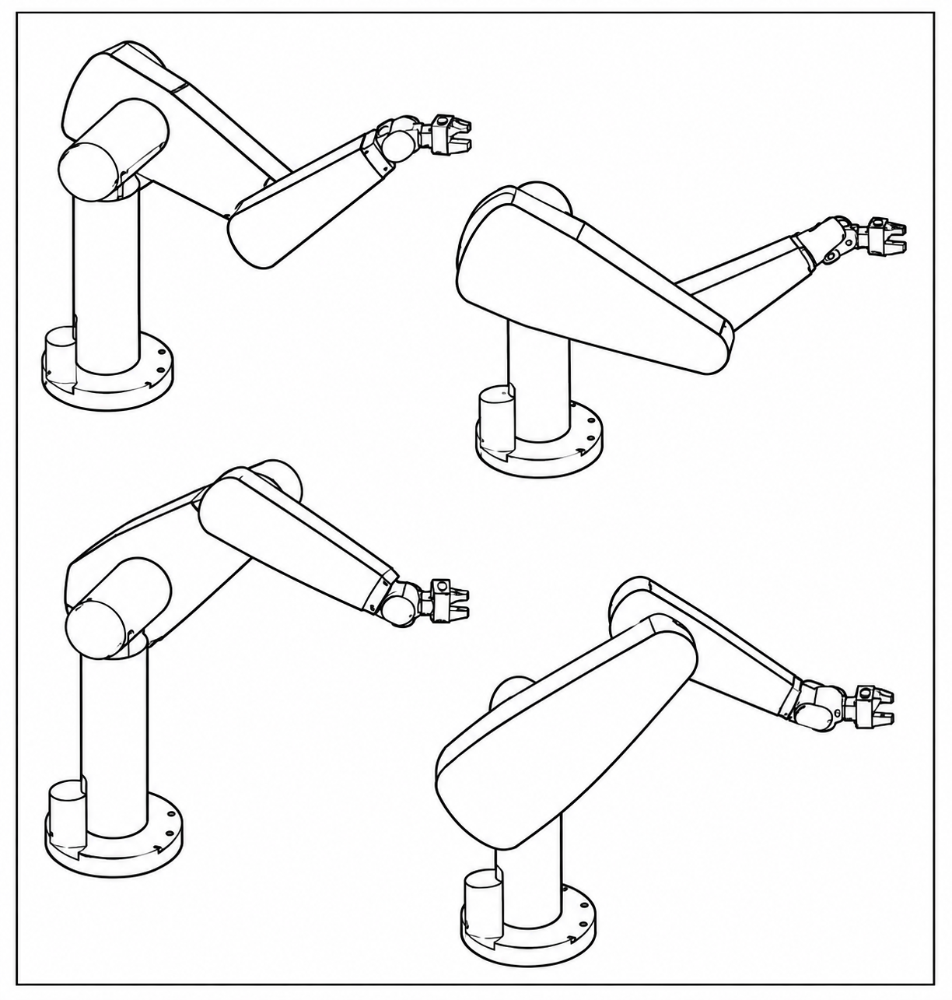
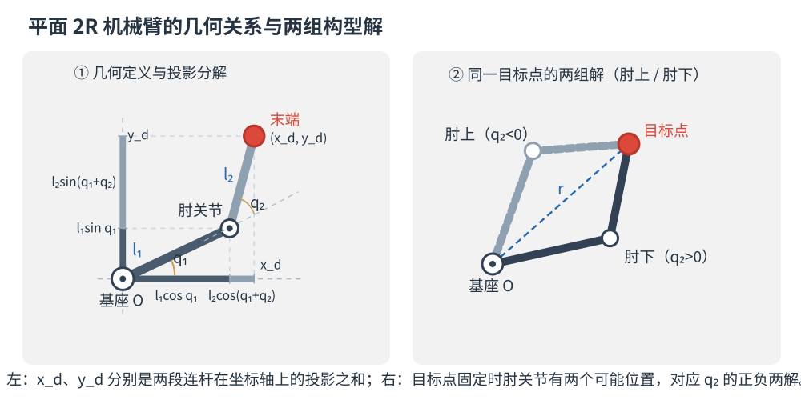
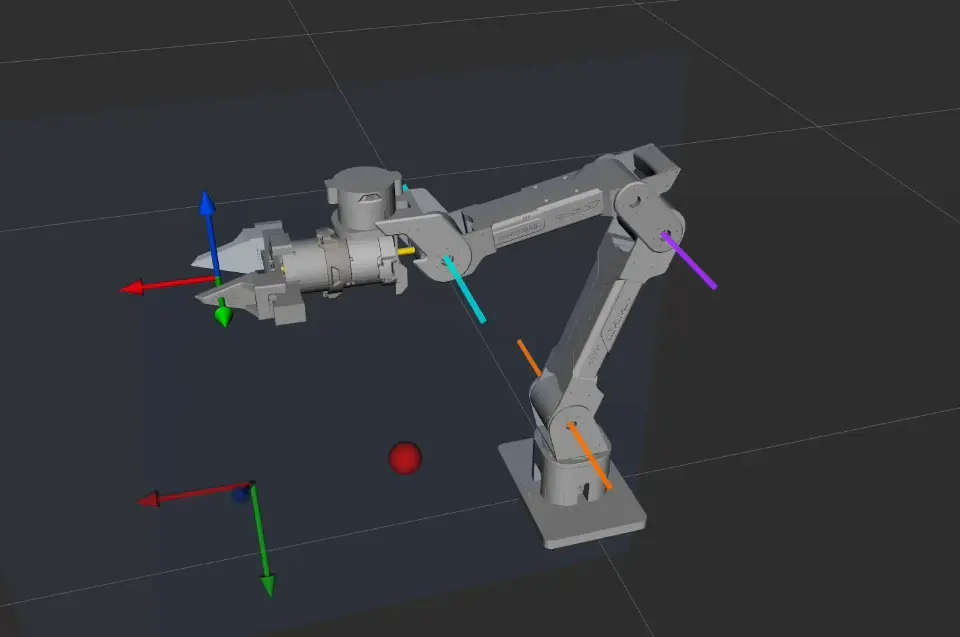
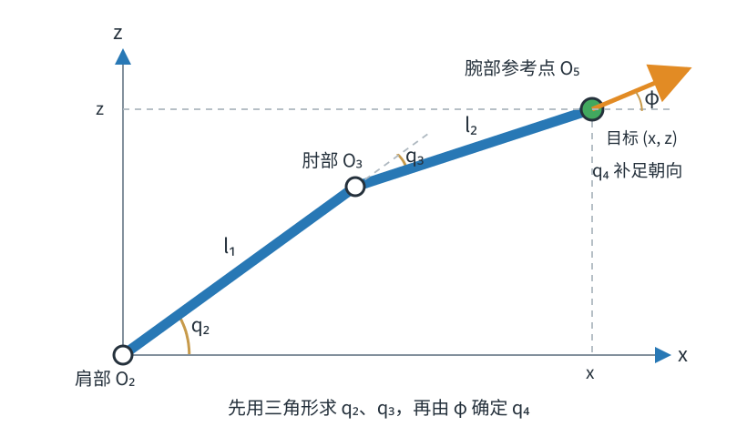
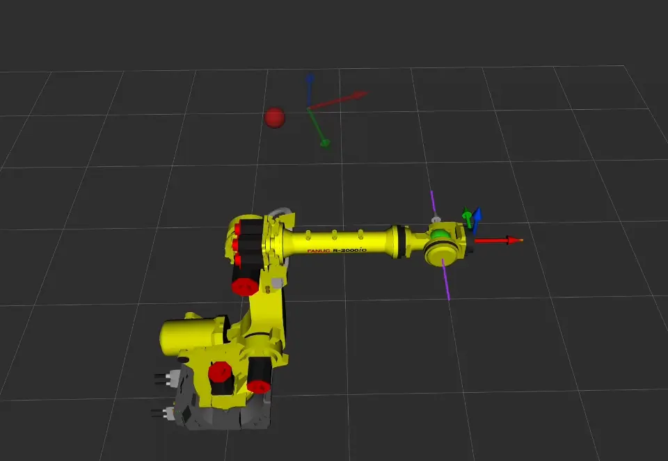

# 第三章 位置逆运动学

> 📌 **概述**：本章研究由末端目标位姿反求关节角的问题。先用平面 2R 机械臂说明可达性和多解，再介绍 JoyArm 的解析解与通用数值解，最后通过正运动学回代验证结果。


## 1 位置逆运动学的可解性


正运动学根据已知关节变量计算末端位姿；逆运动学则根据给定的末端位置或位姿，反求机械臂的关节变量。逆运动学求解前，首先需要判断目标是否可达；只有目标位于机械臂的工作空间内，逆解才可能存在。


> 📌 **记号约定**：本章记 $\mathcal{Q}$ 为**关节空间**，即关节变量 $\bm q$ 的允许取值范围；$\mathbb{R}^3$ 为**三维实数空间**，即所有形如 $(x,y,z)$ 的位置坐标构成的集合；$\mathcal{W}_{\mathrm{R}}$、$\mathcal{W}_{\mathrm{D}}$ 分别表示可达、灵巧工作空间。其余记号沿用[第二章](chapt2_fkine.md)。

### 1.1 工作空间与可达点


机械臂末端执行器在关节运动范围内能够到达的全部空间位置，称为**可达工作空间**（reachable workspace）。

例如，对于两连杆平面 $2R$ 机械臂，连杆长度分别为 $l_1$ 和 $l_2$，末端到基座原点的距离记为：

$$
r=\sqrt{x_{\mathrm d}^2+y_{\mathrm d}^2}
$$

在不考虑关节限位时，目标点可达的条件为：

$$
|l_1-l_2|\leq r\leq l_1+l_2
$$

这说明末端只能到达一个环形区域：距离过远时，两根连杆无法伸到目标点；距离过近时，连杆即使完全折叠也无法到达目标点。

同时需要注意：目标位置可达，不代表任意姿态都可达，能够以任意姿态到达的位置叫作灵巧工作空间，它通常小于可达工作空间。本章只需要知道这一差别，不展开计算。

### 1.2 逆运动学解的个数

目标可达不代表关节角唯一，机械臂可能以不同的肩部、肘部、腕部姿态达到同一个末端目标。满足目标位姿的全部关节角可以写成一个解集，如下：

$$
\mathcal{Q}_{\mathrm d}
=
\left\{
\bm q\in\mathcal Q
\mid
f(\bm q)={}^0_e\bm T_{\mathrm d}
\right\}
$$

这个集合可能为空、只包含一组解，也可能包含多组解。多解主要由机械臂的构型、关节周期性和冗余自由度共同产生。比如说肘部可以采用肘上或肘下构型，腕部也可能出现翻转前后的两组姿态。

以经典的 PUMA 560 为例，同一个末端位姿可以由多组关节角实现：



当目标靠近工作空间边界或奇异位形时，有些解会重合或消失；再加上关节限位，一些数学上成立的解也会被排除。所以，程序不光要算出候选解，还得从中挑出一组真正适合运动的解，一般会优先选离当前关节角近、不超限位、又远离奇异位形的那些。


## 2 平面 2R 机械臂的解析解

逆运动学就是已知末端目标，反推关节角。如果目标只有末端位置，叫位置逆运动学；位置和姿态都要满足，叫完整位姿逆运动学。解析法利用代数或几何关系直接得到关节角；数值法则从初值开始迭代逼近目标（见[第 5 节](#5)）。

平面 2R 机械臂能够同时说明解析法的两个基本思路。设两段连杆长度为 $l_1,l_2$，关节角为 $q_1,q_2$，目标位置为 $\bm p_{\mathrm d}=(x_{\mathrm d},y_{\mathrm d})$：



### 2.1 几何关系与解析结果

基座、肘关节和目标点构成一个三角形。记目标到基座的距离为

$$
r=\sqrt{x_{\mathrm d}^2+y_{\mathrm d}^2}
$$

对三角形使用余弦定理，可以直接得到肘关节角：

$$
q_2=\pm\arccos\!\left(\frac{r^2-l_1^2-l_2^2}{2l_1l_2}\right)
\tag{1}
$$

正、负两支分别对应肘上和肘下两种构型。选定 $q_2$ 后，肩关节角为

$$
q_1=\operatorname{atan2}(y_{\mathrm d},x_{\mathrm d})
-\operatorname{atan2}\!\bigl(l_2\sin q_2,\;l_1+l_2\cos q_2\bigr)
\tag{2}
$$

第一项确定目标方位，第二项根据肘部弯曲程度修正第一根连杆的方向。当 $r=l_1+l_2$ 或 $r=|l_1-l_2|$ 时，两组解重合；当 $r$ 超出这一范围时，目标不可达。

### 2.2 代数法如何得到相同结论

代数法把正运动学展开为标量方程，再通过消元和回代得到式（1）、式（2）。它与几何法给出相同结果，只是观察问题的角度不同：几何法直接使用三角形关系，代数法更容易逐步转化为程序。

<details class="tutorial-details" markdown="1">
<summary>详细推导：消去 q₁ 并回代</summary>

平面 2R 的正运动学方程为

$$
\begin{cases}
x_{\mathrm d}=l_1\cos q_1+l_2\cos(q_1+q_2)\\[4pt]
y_{\mathrm d}=l_1\sin q_1+l_2\sin(q_1+q_2)
\end{cases}
$$

将两式平方后相加，可以消去 $q_1$：

$$
r^2=x_{\mathrm d}^2+y_{\mathrm d}^2
=l_1^2+l_2^2+2l_1l_2\cos q_2
$$

因此

$$
\cos q_2=\frac{r^2-l_1^2-l_2^2}{2l_1l_2}
$$

反余弦的正负两支给出式（1）。选定 $q_2$ 后，用和角公式展开正运动学方程，并按 $\cos q_1$、$\sin q_1$ 整理：

$$
\cos q_1=\frac{(l_1+l_2\cos q_2)x_{\mathrm d}+(l_2\sin q_2)y_{\mathrm d}}{D}
$$

$$
\sin q_1=\frac{(l_1+l_2\cos q_2)y_{\mathrm d}-(l_2\sin q_2)x_{\mathrm d}}{D}
$$

其中 $D=l_1^2+l_2^2+2l_1l_2\cos q_2=r^2$。把两式分别作为纵、横分量送入 $\operatorname{atan2}$，即可得到式（2）。使用 $\operatorname{atan2}$ 而不是 $\arctan$，可以保留象限信息，避免漏解。

</details>

实际推导经常混合使用两种方法：先利用构型把空间问题化为平面几何，再用代数公式计算各个解支。2R 方程较少，可以逐次消元得到闭式解；通用 6R 的解析推导通常十分复杂，工程中常利用连续平行轴、球形腕等结构获得易实现的闭式解，其余构型更常采用数值方法。

对应的交互演示位于 `joyarm_code/chapt/chapt3/chapt3_2r_demo.py`。移动目标点可以观察肘上、肘下、边界两解重合以及目标不可达等情况。

## 3 JoyArm 连续三轴平行构型的解析解法

能够获得易实现闭式解的一类经典构型是**连续三轴平行**——连续三个关节轴线相互平行，臂部在其中一段上"折叠"。**JoyArm 正属此类**：其第 2、3、4 轴相互平行，第 5、6 轴相交。下面用忽略侧向偏置和腕部固定长度的简化几何讲解求解顺序，并假设各关节的零位偏角均为 0；具体机械臂的求解式仍须按实际连杆参数确定。

### 3.1 构型特征与解耦思想

观察本节机械臂构型可以看到：$\hat{Z}_2\parallel\hat{Z}_3\parallel\hat{Z}_4$ 。当 $q_1$ 固定时，这三个关节带动机械臂在同一个平面内运动。它们既能改变机械臂的弯曲形状，也会共同改变末段连杆在平面内的朝向。

对于本节采用的轴线方向，三个关节对末段朝向的共同作用可以合并为一个角：

$$
\phi=-q_2+q_3+q_4
$$

式中的正负号取决于各关节轴的方向和坐标系定义，换一台机械臂后不一定相同。

$\phi$ 表示末段连杆在运动平面内的合成朝向，但它不能单独确定腕部参考点的位置。即使 $\phi$ 相同，不同的 $q_2,q_3,q_4$ 组合仍然可以形成不同的臂形，使腕部参考点落在不同位置。$\phi$ 已知后，我们只能确定末段连杆在目标位置中占据的方向和投影；扣除这部分投影，剩余位置才能化为平面 2R 问题。

> 📌 **求解顺序提示**：先由目标腕部位置确定 $q_1$，再由目标姿态解出合角 $\phi$ 与腕角 $q_5,q_6$，最后利用目标位置和已知的 $\phi$ 反推 $q_2,q_3,q_4$（见 [3.3](#33-phiq_5q_6) 与 [3.4](#34-phi-q_2q_3q_4)）。这与球形腕（[第 4 节](#4-6r)）“前三轴定位置、后三轴定姿态”的解耦方式不同。



| 步骤 | 动画过程 | 观察重点 |
|:---:|:---:|:---:|
| 1 | 橙、紫、青三条直线分别显示第 2、3、4 关节轴线，半透明蓝色区域显示三条平行轴共同形成的运动平面 | 黄色箭头表示 \(\phi\) 对应的末段朝向；绿色球表示当前腕部参考点 \(O_5\)，红色球表示目标位置 |
| 2 | 根据目标腕部位置求解 \(q_1\)，由第 1 关节带动运动平面转向目标方位 | \(q_1\) 决定机械臂运动平面的空间朝向，使后续位置求解可以在该平面内进行 |
| 3 | 根据目标姿态求解 \(\phi,q_5,q_6\)，实线 RGB 坐标轴逐渐与半透明目标坐标轴重合 | 此时末端姿态已经与目标一致，但绿色腕部参考点 \(O_5\) 尚未到达红色目标位置 |
| 4 | 保持 \(\phi,q_5,q_6\) 不变，联动 \(q_2,q_3,q_4\) 调整机械臂臂形 | 末端姿态保持不变，绿色腕部参考点逐渐移动到红色目标位置，完成位置与姿态的解耦求解 |

因此，本节采用的求解顺序是：

$$
q_1
\quad\longrightarrow\quad
(\phi,q_5,q_6)
\quad\longrightarrow\quad
(q_2,q_3,q_4)
$$

球形腕可以把位置和姿态分别交给前三轴与后三轴；连续三轴平行构型则需要先从目标姿态中取得后续位置求解所需的 $\phi$，再完成平面内的位置计算。

### 3.2 求 $q_1$：腕部参考点的水平投影

先看腕部参考点与第 1 轴之间没有侧向偏置的简化情况。设腕部参考点 $O_5$ 与末端系原点重合，其目标位置为 ${}^0\bm p_{O_5}=(x_5,y_5,z_5)$。从上方看，$O_5$ 的水平投影方向就是第 1 轴的转角，因此

$$
q_1=\operatorname{atan2}(y_5,x_5)
$$

若机械臂存在侧向偏置，$q_1$ 就不能只由一个方位角得到，还需要把偏置形成的三角关系计入，并检查相差 $180°$ 的另一肩部分支。若 $(x_5,y_5)=(0,0)$，水平投影本身也无法确定 $q_1$，此时需要结合目标姿态或选定参考角继续求解。

### 3.3 姿态子问题：先解出 $\phi,q_5,q_6$

第 2、3、4 轴都会改变末段朝向，但只根据目标姿态，还不能确定三个关节各自的转角。求解时先把它们对姿态的共同作用合并为平面朝向角 $\phi$：

$$
\phi=-q_2+q_3+q_4
$$

这样一来，姿态子问题中只剩三个待求量：$\phi$、$q_5$ 和 $q_6$。先从目标姿态求出这三个量，下一节再结合目标位置，把 $\phi$ 分解为具体的 $q_2,q_3,q_4$。

具体做法是先去掉已经求出的第 1 轴转动和基座固定扭转。设目标末端姿态为 ${}^0_6\bm R$，把这两部分合记为

$$
\bm B=\bm R_Z(q_1)\bm R_X(-\tfrac{\pi}{2})
$$

则约化后的姿态为 $\bm Q=\bm B^{\top}{}^0_6\bm R$。此时 $\bm Q$ 只包含“平面合角 + 后两轴”的旋转：

$$
\bm Q=
\underbrace{\bm R_Z(\phi)}_{\text{第 2～4 轴的合成朝向}}
\bm R_X(\alpha_4)
\underbrace{\bm R_Z(q_5)}_{\text{第 5 轴}}
\bm R_X(\alpha_5)
\underbrace{\bm R_Z(q_6)}_{\text{第 6 轴}}
$$

理解到这里，就已经掌握了本节的主要思路：**先不区分 $q_2,q_3,q_4$，而把它们对姿态的作用压缩成一个 $\phi$**。

<details class="tutorial-details" markdown="1">
<summary>拓展：从姿态矩阵提取三个角</summary>

下面给出程序中提取三个角的方式，用来说明上述分解如何落地。它只适用于本节采用的扭角配置，尤其用到了 $\alpha_5=\pi/2$ 且 $\sin\alpha_4\ne0$；更换机械臂构型后，需要重新展开对应的姿态矩阵。先由 $\bm Q$ 的 $(2,2)$ 元素求 $q_5$：

$$
\cos q_5=-\frac{Q_{22}}{\sin\alpha_4},\qquad
q_5=\operatorname{atan2}\!\bigl(\pm\sqrt{1-\cos^2q_5},\;\cos q_5\bigr)
$$

正负号给出两组腕部翻转分支。选定一组 $q_5$ 后，再依次求 $\phi$ 和 $q_6$：

$$
\phi=\operatorname{atan2}(Q_{12},Q_{02})
-\operatorname{atan2}\!\bigl(-\cos\alpha_4\cos q_5,\;\sin q_5\bigr)
$$

$$
q_6=\operatorname{atan2}(R_{10},R_{00})
$$

其中 $\bm R=\bigl[\bm R_Z(\phi)\bm R_X(\alpha_4)\bm R_Z(q_5)\bm R_X(\alpha_5)\bigr]^{\top}\bm Q$，也就是从 $\bm Q$ 中继续去掉已经求出的 $\phi$ 和 $q_5$，剩下的旋转用于求 $q_6$。

当 $|\sin q_5|\to0$，即 $q_5=0$ 或 $180°$ 时，$\phi$ 与 $q_6$ 只以组合角 $(\phi\pm q_6)$ 出现，无法单独确定。此时按 [1.2 节](#12) 的思路取一个代表解：固定 $q_6$ 的参考值（代码用 $q_6^{\text{ref}}$，默认取初值），再由组合角反求 $\phi$。

</details>

> 📌 **要点**：这是三轴平行构型与球形腕最大的不同——**姿态方程顺带解出了位置子问题所需的 $\phi$**，而不是"位置定腕心 → 姿态定腕角"。

### 3.4 位置子问题：由 $\phi$ 解出 $q_2,q_3,q_4$

求出 $q_1$ 后，第 2、3、4 轴的运动可以看成一个平面问题。把腕部参考点 $O_5$ 变换到这个平面内：

$$
{}^1\bm p_{O_5}={}^0_1\bm R^{\top}\bigl({}^0\bm p_{O_5}-{}^0\bm p_1\bigr)
$$

在本节的简化几何中，$O_5$ 在第 1 系中的平面坐标记为

$$
x={}^1 p_{O_5,x},\qquad z={}^1 p_{O_5,z}
$$

这里沿用 [第 2 节](#2-2r) 的平面 2R 定义：两段连杆长度仍记为 $l_1,l_2$。由于它们对应当前机械臂的第 2、3 关节，两个关节角相应记为 $q_2,q_3$；其中 $q_2$ 是第一段连杆相对平面 $x$ 轴的转角，$q_3$ 是第二段连杆相对第一段连杆的转角。肩部、肘部和 $O_5$ 构成一个三角形，因此可以先用余弦定理求出 $q_3$：



$$
\cos q_3=\frac{x^2+z^2-l_1^2-l_2^2}{2l_1l_2}
$$

反余弦给出的正负两组结果对应肘上和肘下两种构型。选定 $q_3$ 后，再根据目标点的方向求肩关节 $q_2$：

$$
q_2=
\underbrace{\operatorname{atan2}(z,x)}_{\text{目标点的方向}}
-\underbrace{\operatorname{atan2}\!\bigl(l_2\sin q_3,\;l_1+l_2\cos q_3\bigr)}_{\text{连杆弯曲带来的修正角}}
$$

此时 $q_2,q_3$ 已经使腕部参考点到达目标位置，但末段朝向还不一定等于 3.3 节求出的 $\phi$。最后用 $q_4$ 补足剩余角度：

$$
q_4=\phi+q_2-q_3
$$

因此，这一步可以概括为：用三角形确定 $q_2,q_3$，再用 $q_4$ 补足末段朝向。

上面的公式为了突出求解顺序，省略了固定偏置、零位偏角和解支管理。工程代码中的对应关系如下：

| 简化公式或步骤 | 工程代码中的对应处理 |
|:---:|:---:|
| 将 TCP 目标换算为第 6 坐标系目标 | `_target_link6()` 去除 TCP 与第 6 坐标系之间的固定变换 |
| $q_1=\operatorname{atan2}(y_5,x_5)$ | `_solve_q1()` 同时计入侧向偏置、关节零位和两个肩部分支 |
| 由约化姿态求 $\phi,q_5,q_6$ | `_reduced_orientation()` 与 `_solve_phi_q56()` 计入 MDH 扭角、腕部翻转分支和腕部奇异 |
| 由平面几何求 $q_2,q_3,q_4$ | `_solve_q234()` 先扣除固定投影与零位偏角，再枚举肘部解支 |
| 组合并选取最终关节角 | `solve_all()` 处理 $2\pi$ 周期、关节限位、正运动学回代、去重与排序 |

这些函数位于 `joyarm_code/joyarm_core/robotics/ikine/ikine_solver_analytic.py`。阅读代码时可以沿表中顺序，将每一步与本节公式逐项对应。

### 3.5 与球形腕构型对比

| 维度 | JoyArm 连续三轴平行（§3） | 球形腕（§4） |
|:---:|:---:|:---:|
| **求解顺序** | **先姿态、后位置** | 先位置、后姿态 |
| 位置子问题 | 已知 $\phi$ 后，平面 2R 解 $(q_2,q_3,q_4)$ | 前 3 轴 → 腕心（3 未知量） |
| 姿态子问题 | 先解 $(\phi,q_5,q_6)$（含平面合角） | 后 3 轴正交 → ZYZ 欧拉角 |
| 解的组数 | 最多 8 | 最多 8 |
| 典型机型 | JoyArm 等三轴平行肘式臂 | 多数工业 6R（如 PUMA 类） |

> 💡 **一句话总结**：连续三轴平行的解析解 = **用平行轴的合角把位置压到平面 + 用相交腕轴定姿态**。它与球形腕殊途同归——都是"利用构型特征解耦"，这也是 [第 5 节](#5) 数值法之外的解析解通用套路。本节公式采用简化几何；JoyArm 的具体实现见 `joyarm_code/joyarm_core/robotics/ikine/ikine_solver_analytic.py`。


## 4 拓展：末三轴相交的 6R 机械臂

除连续三轴平行构型外，工程中另一类常见的可解析构型是**末三轴相交**的 6R 机械臂，也称为球形腕。第 4、5、6 关节轴线交于腕心 $W$；后三轴转动会改变末端姿态，却不会改变腕心位置。因此，完整逆解可以拆成两个子问题：

| 子问题 | 待求量 | 核心思路 |
|:---:|:---:|:---:|
| 位置子问题 | $q_1,q_2,q_3$ | 由目标位姿反推腕心，再由前三轴把腕心移动到目标位置 |
| 姿态子问题 | $q_4,q_5,q_6$ | 消去前三轴姿态后，对剩余旋转作 ZYZ 欧拉角分解 |



| 步骤 | 动画过程 | 观察重点 |
|:---:|:---:|:---:|
| 1 | 第 4、5、6 关节同时转动，末端姿态不断变化 | 绿色腕心始终保持不动，体现末三轴相交的几何性质 |
| 2 | 第 1、2、3 关节开始运动 | 前三轴负责改变腕心位置，将绿色腕心移向红色目标点 |
| 3 | 腕心与目标点重合，前三轴停止运动 | 腕心定位完成，位置子问题结束 |
| 4 | 第 4、5、6 关节继续调整末端姿态 | 实线 RGB 坐标轴与半透明目标坐标轴重合，姿态子问题结束 |

<details class="tutorial-details" markdown="1">
<summary>详细推导：腕心定位与 ZYZ 姿态分解</summary>

**1. 由目标位姿反推腕心**

设目标位姿为 ${}^0_6\bm T$，末端坐标系原点到腕心的固定偏置在 $\{6\}$ 中为 ${}^6\bm p_W$，则腕心在基座系中的位置为

$$
{}^0\bm p_W={}^0_6\bm R\,{}^6\bm p_W+{}^0\bm p_6
$$

先用目标姿态把固定偏置转到基座系，再加上目标末端位置，就能得到目标腕心位置。

**2. 由腕心求 $q_1,q_2,q_3$**

记 ${}^0\bm p_W=(x_W,y_W,z_W)$。在没有侧向偏置的简化构型中，第一关节角由腕心的水平投影确定：

$$
q_1=\operatorname{atan2}(y_W,x_W)
\quad\text{（另一个候选方向相差 }180^\circ\text{）}
$$

将腕心变换到第 1 坐标系，并扣除肩部固定偏置后，平面内目标坐标记为 $(x,z)$。问题化为第 2 节的平面 2R 逆解：

$$
\gamma=\frac{x^2+z^2-l_1^2-l_2^2}{2l_1l_2},\qquad
q_3=\pm\arccos(\gamma)
$$

$$
q_2=\operatorname{atan2}(z,x)
-\operatorname{atan2}\!\bigl(l_2\sin q_3,\;l_1+l_2\cos q_3\bigr)
$$

只有 $\gamma\in[-1,1]$ 时才有实数解。其他球形腕机械臂仍然先求腕心，但前三轴的具体公式必须根据实际尺寸和轴线布局推导。

**3. 消去前三轴并分解腕部姿态**

前三轴求出后，${}^0_3\bm R$ 已知，因此

$$
{}^3_6\bm R=({}^0_3\bm R)^{\top}{}^0_6\bm R
$$

对常见的正交球形腕，剩余姿态可写成 ZYZ 欧拉角形式：

$$
{}^3_6\bm R=\bm R_Z(q_4)\bm R_Y(q_5)\bm R_Z(q_6)
$$

设 ${}^3_6\bm R=[r_{ij}]$，一组角度可以由下式提取：

$$
q_5=\operatorname{atan2}\!\bigl(\sqrt{r_{13}^2+r_{23}^2},\,r_{33}\bigr)
$$

$$
q_4=\operatorname{atan2}(r_{23},r_{13}),\qquad
q_6=\operatorname{atan2}(r_{32},-r_{31})
$$

当 $\sin q_5=0$ 时，$q_4$ 与 $q_6$ 只以组合角出现，无法分别确定。此时需要固定其中一个角，再求另一个代表解。

</details>

位置子问题通常产生肩部和肘部解支，姿态子问题还会产生腕部翻转解支，因此经典球形腕最多可能组合出

$$
2\times2\times2=8
$$

组候选解。目标不可达、关节限位、奇异性和正运动学回代误差会继续剔除部分候选，因此有效解通常少于 8 组。这里的“最多 8 组”描述的是经典构型下的候选上限，并不意味着任意 6R 机械臂都固定具有 8 组逆解。

## 5 机械臂逆运动学的数值解法

第 3、4 节的解析解依赖特定构型。对于没有闭式解的机械臂，可以从一组初始关节角出发，不断修正关节角，使末端逐步靠近目标位姿。这就是数值逆运动学。实际使用时，雅可比和关节修正量由 Pinocchio 计算。这里重点说明数值逆解的迭代过程。

### 5.1 数值逆解在做什么

数值逆解没有一步到位的公式，而是反复执行下面四步：

1. 给定一组初始关节角 $\bm q_0$；
2. 用正运动学计算当前末端位姿；
3. 比较当前位姿与目标位姿，得到误差；
4. 根据误差计算关节修正量，更新关节角。

更新后的关节角会再次进入正运动学。如果误差已经足够小，就返回当前结果；否则继续迭代。

数值逆解就是先给出一组关节角，再根据末端偏差反复修正。

### 5.2 如何表示位姿误差

末端位姿同时包含位置和姿态。位置可以直接相减：

$$
\bm e_p(\bm q)=\bm p_{\mathrm d}-\bm p(\bm q)
$$

姿态不能直接用两个旋转矩阵相减。这里用“从当前姿态转到目标姿态所需的最小旋转”表示姿态误差：

$$
\bm e_R(\bm q)
=
\log_3\!\bigl(\bm R_{\mathrm d}\bm R(\bm q)^{\top}\bigr)
$$

$\log_3$ 把两个姿态之间的相对旋转变成三维旋转向量。将位置误差和姿态误差合在一起，得到六维误差：

$$
\bm e(\bm q)=
\begin{bmatrix}
\bm e_p(\bm q)\\
\bm e_R(\bm q)
\end{bmatrix}
$$

求解器用下面的残差判断是否收敛：

$$
\varepsilon(\bm q)
=
\|\bm e_p(\bm q)\|_2
+
\|\bm e_R(\bm q)\|_2
$$

当 $\varepsilon(\bm q)<\mathrm{tol}$ 时，就认为当前关节角已经满足目标位姿。

### 5.3 如何修正关节角

雅可比矩阵 $\bm J$ 描述“关节角发生微小变化时，末端位姿会怎样变化”。反过来利用这个关系，就能根据末端误差估计关节修正量，记为 $\Delta\bm q$。求解器使用阻尼伪逆限制奇异附近过大的修正，以少量末端误差换取更稳定的迭代。

<details class="tutorial-details" markdown="1">
<summary>拓展：阻尼伪逆公式与阻尼参数</summary>

关节修正量可以写成

$$
\Delta\bm q=\bm J_{\lambda}^{+}\bm e
$$

一种常用的阻尼伪逆形式为

$$
\bm J_{\lambda}^{+}
=\bm J^T
\left(\bm J\bm J^T+\lambda^2\bm I\right)^{-1}
$$

普通伪逆在奇异位形附近可能产生很大的关节修正量；阻尼参数 $\lambda$ 用来压小这些不稳定的修正。$\lambda$ 较小时，求解器更积极地靠近目标；$\lambda$ 较大时，关节修正更保守，但末端误差也可能增大。

Levenberg–Marquardt（LM）方法会根据本次修正是否让误差下降，自动调整 $\lambda$。阻尼伪逆只能缓和数值放大，不能消除机械臂几何结构本身的奇异性。其进一步推导属于奇异值分解、最小二乘与正则化内容。

</details>

得到修正量后，更新关节角并限制在关节范围内：

$$
\bm q_{k+1}
=
\operatorname{clip}\!\bigl(
\bm q_k+\Delta\bm q_k
\bigr)
$$

雅可比的具体构造和奇异性将在[第四章](chapt4_jacobian.md)中介绍。实际运行时，Pinocchio 会计算正运动学、雅可比和关节修正量，不需要使用者手工展开这些矩阵。

### 5.4 初值与奇异

数值解依赖初值 $\bm q_0$。初值靠近目标解时，通常只需少量迭代；初值较远时，求解可能变慢、落入另一组解，或者无法收敛。

奇异位形附近，某些方向上的末端运动需要很大的关节变化。阻尼可以减轻修正量突然放大的问题，但不能保证每次都成功。求解过程中还需要限制单步修正量，并把关节角钳在硬限位内。


### 5.5 与解析解的关系

| 维度 | 解析解（§3、§4） | 数值解（本节） |
|:---:|:---:|:---:|
| 适用构型 | 依赖特殊几何 | 任意构型 |
| 解的性质 | 可枚举多组候选解 | 通常返回一组局部解 |
| 计算方式 | 直接计算 | 从初值反复迭代 |
| 初值依赖 | 通常不依赖 | 明显依赖 |
| 奇异附近 | 需要单独处理 | 可用阻尼缓和 |
| 失败处理 | 检查可达性与候选分支 | 调整初值或随机重启 |

连续轨迹中通常把上一时刻的关节角作为下一时刻的初值，这样既能减少迭代次数，也能降低解分支突然跳变的概率。

实际使用以 `PinIkineSolver` 为主，其实现位于 `joyarm_code/joyarm_core/robotics/ikine/ikine_solver_pin.py`。使用者只需要给出目标位姿、目标帧和初值 $\bm q_0$，必要时再设置 `tol`、`iters`；求解器内部完成正运动学、雅可比、LM 迭代和随机重启，并返回 `IKResult(success, q, err, n_iter)`。解析解对应同目录的 `AnalyticIkineSolver`；`solve` 返回距离 $\bm q_0$ 最近的一组解，`solve_all` 返回全部有效候选解。

## 6 本章实践：使用 Pinocchio 实现 JoyArm 逆运动学

本实践把第 5 节介绍的数值逆解流程写成一个标准求解器。目标位姿、连续初值、正运动学回代、参考结果和三维显示均已给出，实践重点只有一个：继承 `IkineSolver`，在子类的 `solve()` 中使用 Pinocchio 完成 JoyArm 数值逆解。整个实验离线运行，无需连接机械臂。

### 6.1 实践任务与接口

对应脚本位于 `joyarm_code/chapt/chapt3/chapt3_ikine_exercise.py`，使用说明见脚本头部注释。脚本已经定义 `PracticePinIkineSolver` 子类，并在 `solve()` 中标出实践实现区。

实践实现区默认抛出 `NotImplementedError`。先根据区内提示补全迭代求解过程，再运行后续校验与 MeshCat 对照。

| 已提供内容 | 需要完成的内容 |
|:---:|:---:|
| `IkineSolver` 基类和 `solve()` 接口 | 创建 Pinocchio 计算数据并读取目标帧 |
| JoyArm 模型、三个相邻目标位姿 | 计算当前位姿和六维位姿误差 |
| 连续目标求解流程 | 调用 Pinocchio 获取雅可比并计算关节修正量 |
| 回代校验和库内参考结果 | 限制步长、更新关节角并判断收敛 |
| 结果表格和 MeshCat 路径播放 | 返回统一的 `IKResult` |

`solve()` 的输入包含目标位姿、目标帧、初始关节角、收敛阈值和最大迭代次数；输出统一为 `IKResult`。求解成功时，`success=True`，并在 `q`、`err` 和 `n_iter` 中分别记录关节角、末端残差和迭代次数。达到最大迭代次数仍未收敛时，应返回迭代过程中的最优结果，并令 `success=False`。

### 6.2 使用 Pinocchio 完成迭代

首先从 `arm.pin_model` 取得 Pinocchio 模型，为本次求解创建私有的 `pin.Data`，并把目标帧名转换为帧编号。每轮迭代调用 `pin.forwardKinematics()` 和 `pin.updateFramePlacement()` 得到当前末端位姿，再计算六维误差：

$$
\bm e
=
\begin{bmatrix}
\bm p_{\mathrm d}-\bm p\\
\log_3\!\left(\bm R_{\mathrm d}\bm R^T\right)
\end{bmatrix}
$$

当位置误差范数与姿态误差范数之和小于 `tol` 时，认为求解收敛。尚未收敛时，调用 `pin.computeFrameJacobian()` 获取当前雅可比，并用第 5 节给出的阻尼修正关系计算关节增量：

$$
\Delta\bm q
=
\bm J^T
\left(
\bm J\bm J^T+\lambda^2\bm I
\right)^{-1}
\bm e
$$

随后限制 $\|\Delta\bm q\|$，避免单步修正过大；通过 `pin.integrate()` 更新关节角，并把结果裁剪到 JoyArm 的硬限位内。新的关节角进入下一轮迭代。

> 📌 **与第四章的边界**：本实践把 `pin.computeFrameJacobian()` 当作库接口使用，不要求推导或手工构造雅可比矩阵。雅可比各列的物理意义、计算方法和奇异性分析将在[第四章](chapt4_jacobian.md)展开。

本实践只实现单起点和固定阻尼。库内 `PinIkineSolver` 还包含自适应阻尼与失败重启，用于作为工程实现对照，不属于本次实践任务。

### 6.3 运行与校验

进入代码库并运行无界面实验：

```bash
cd joyarm_code
uv sync
uv run python chapt/chapt3/chapt3_ikine_exercise.py --headless
```

程序依次求解三个相邻目标。第一个目标使用给定的起始关节角，后续目标使用上一目标的解作为初值。终端分别输出实践求解器与库内参考求解器的结果，包括关节角、限位状态、位置误差和姿态误差。

去掉 `--headless` 后，MeshCat 会先播放实践求解器路径，再播放参考求解器路径：

```bash
uv run python chapt/chapt3/chapt3_ikine_exercise.py
```

判断实现是否正确时，应检查所有目标是否求解成功、关节角是否位于限位内，以及正运动学回代后的末端误差是否满足阈值。实践求得的关节角不必与参考解完全相同，因为同一末端位姿可能对应多组逆解。
