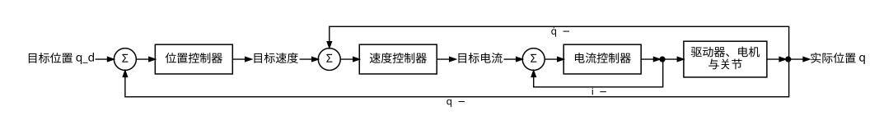
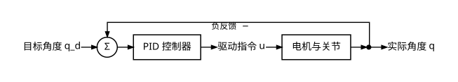
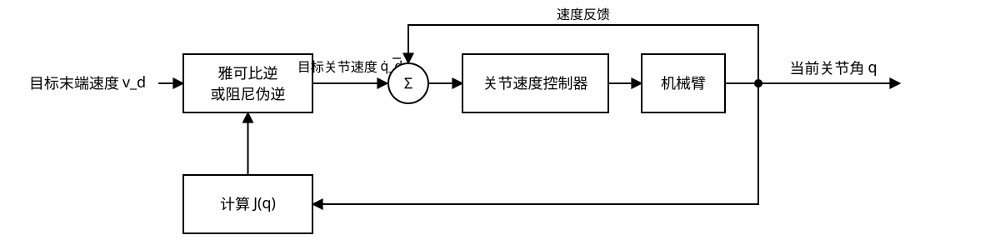

# 第六章 运动控制

> 📌 **概述**：本章把前几章的运动学与轨迹转化为机械臂能够执行的控制指令。首先介绍关节模组的控制模式、通信方式和闭环控制，再讲解基于逆运动学的整机位置控制与基于雅可比矩阵的整机速度控制，最后给出 JoyArm 运动学控制实践的设计与验证方法。

## 1 单关节电机控制

机械臂的每个关节通常由一体化关节模组驱动。关节模组把电机、减速器、编码器、驱动器等部件集成在一起；部分产品还带有力矩传感器。上位机发送位置、速度或力矩指令，模组内部的控制器根据传感器反馈调节电流，使关节按照指令运动。

整机控制并不是绕过单关节控制，而是在其外层计算各关节应该执行的目标。理解单关节控制，是理解整机控制的基础。

### 1.1 位置、速度与力矩控制模式

关节模组常见的位置、速度和力矩模式，区别在于上位机给出的主要目标量不同。

| 控制模式 | 主要指令 | 主要反馈 | 特点 | 典型用途 |
|:---:|:---:|:---:|:---:|:---:|
| 位置模式 | 目标角度 $q_d$ | 关节角度 $q$ | 易于实现定点和轨迹跟踪，使用最直观 | 工业机械臂、教学机械臂 |
| 速度模式 | 目标角速度 $\dot q_d$ | 关节角速度 $\dot q$ | 便于连续调节运动方向与快慢 | 遥操作、视觉伺服 |
| 力矩模式 | 目标力矩 $\tau_d$ | 电流或关节力矩 $\tau$ | 可直接调节关节作用力，但对模型和安全保护要求更高 | 力控制、柔顺控制 |

位置模式并不表示电机内部只控制位置。典型驱动器采用串级控制：位置环输出速度目标，速度环输出电流或力矩目标，最内层电流环驱动电机。内层控制周期通常更快，外层控制周期相对较慢。

> ⚠️ 力矩模式直接影响机械臂与环境之间的作用力。实际设备必须同时设置关节限位、速度限制、力矩限制、急停和通信超时保护。

### 1.2 常见通信方式

上位机需要通过通信链路向各关节发送指令并读取状态。CAN、RS-485 和 EtherCAT 位于通信体系的不同层次：CAN 定义总线通信机制，RS-485 主要定义电气接口，Modbus RTU 等协议可以运行在 RS-485 之上。因此，不应把 RS-485 与 Modbus 当作同一个概念。

| 通信方式 | 主要特点 | 典型拓扑 | 适用场景 | 注意事项 |
|:---:|:---:|:---:|:---:|:---:|
| CAN / CAN FD | 多节点仲裁、抗干扰能力强；CAN FD 可提高数据负载和速率 | 总线型 | 移动机器人、中小型机械臂 | 需要正确配置终端电阻、波特率和节点 ID |
| RS-485 | 差分传输、布线简单，常承载 Modbus RTU 或厂商自定义协议 | 总线型 | 低成本执行器、传感器 | 实时性取决于上层协议和轮询方式 |
| EtherCAT | 周期通信和时钟同步能力强，节点规模扩展方便 | 逻辑环形、物理链式 | 高性能工业运动控制 | 对主站、从站和网络配置要求较高 |

选择通信方式时，应同时考虑控制周期、节点数量、报文长度、同步精度、布线环境和开发成本。通信带宽高并不等于控制效果一定好；如果控制周期抖动大、反馈时间戳不准确或安全机制不完整，机械臂仍可能出现跟踪误差和不稳定运动。

### 1.3 开环与闭环控制

开环控制只根据目标生成指令，不利用实际输出修正指令。例如，给电机固定通电时间来估计转角，负载变化后误差不会自动消除。闭环控制则持续测量实际状态，将目标与反馈之差作为误差，再根据误差计算新的控制量。

以单关节位置控制为例，位置误差与 PID 控制律分别为

$$
e(t)=q_d(t)-q(t),
$$

$$
u(t)=K_p e(t)+K_i\int_0^t e(\xi)\,\mathrm{d}\xi+K_d\dot e(t).
$$

其中，$u(t)$ 是发送给内层控制环的控制量。比例项根据当前误差立即修正；积分项累积历史误差，可减小稳态误差；微分项反映误差变化趋势，可增加阻尼。比例增益过大可能引起振荡，积分过强容易产生积分饱和，微分项则对测量噪声较敏感。

实际调参不能只追求“响应快”，还要观察超调量、稳定时间、稳态误差和噪声。机械臂负载、减速器摩擦及结构柔性变化后，原有参数也可能需要调整。

> 📌 单关节闭环负责让一个关节跟随目标；整机控制负责协调多个关节，为每个单关节闭环生成一致的目标。

## 2 整机位置运动学控制

整机位置运动学控制的目标，是让末端执行器到达给定位置和姿态。其基本过程是：根据目标末端位姿求解逆运动学，得到目标关节角，再由各关节的位置闭环执行。

### 2.1 从末端目标到关节目标

设机械臂正运动学为

$$
\bm{T}=f(\bm{q}),
$$

其中，$\bm{q}$ 为关节角向量，$\bm{T}$ 为末端位姿。对于目标位姿 $\bm{T}_d$，逆运动学求解满足

$$
f(\bm{q}_d)=\bm{T}_d
$$

的目标关节角 $\bm{q}_d$。各关节随后跟踪 $\bm{q}_d$，实际末端位姿再由正运动学 $f(\bm{q})$ 得到。

[第二章](chapt2_fkine.md)介绍了如何由关节角计算末端位姿，[第三章](chapt3_ikine.md)介绍了如何由末端目标反求关节角。本节把二者放入同一条执行链路。

### 2.2 轨迹跟踪而不是一步跳转

如果把相距较远的 $\bm{q}_d$ 一次发送给关节，驱动器可能以较大的速度和加速度运动，造成冲击。更安全的方法是使用[第五章](chapt5_trajectory.md)生成随时间变化的参考轨迹 $\bm{q}_d(t)$，控制器每个周期只下发当前时刻的参考点。

完整执行顺序如下：

1. 检查目标末端位姿是否位于工作空间内。
2. 通过逆运动学得到候选关节解。
3. 根据当前位置、关节限位和连续性选择合适的解。
4. 从当前关节角到目标关节角生成平滑轨迹。
5. 按固定周期发送轨迹点并读取关节反馈。
6. 监测跟踪误差、限位、通信状态和急停信号。

### 2.3 多解、不可达与奇异性

- **多解**：同一个末端位姿可能对应多组关节角。通常优先选择接近当前姿态且远离关节限位的解。
- **不可达**：目标超出工作空间时，逆运动学没有有效解。控制器应拒绝执行，而不是把无效数值发送给关节。
- **不连续**：相邻目标若选择不同的逆解分支，关节目标可能突然跳变。
- **奇异性**：奇异位形附近，末端的小幅运动可能要求关节快速运动，详见[第四章](chapt4_jacobian.md)。

> 💡 位置运动学控制结构清晰，适合定点运动和关节轨迹跟踪；但只逐点求逆运动学，不能直接限定末端瞬时速度，因此还需要速度运动学控制。

## 3 整机速度运动学控制

速度运动学控制直接建立末端速度与关节速度之间的关系。它适合末端连续跟踪、遥操作和视觉伺服等任务。

### 3.1 雅可比速度映射

末端速度旋量 $\bm{v}$ 与关节速度 $\dot{\bm{q}}$ 满足

$$
\bm{v}=\bm{J}(\bm{q})\dot{\bm{q}},
$$

其中，$\bm{J}(\bm{q})$ 为雅可比矩阵。一般可使用伪逆计算关节速度：

$$
\dot{\bm{q}}=\bm{J}^{\dagger}(\bm{q})\bm{v}_d.
$$

控制器按周期更新雅可比矩阵，把目标末端速度转换为关节速度指令。

### 3.2 加入位姿误差反馈

只发送前馈速度时，模型误差、离散积分误差和外部扰动会逐渐累积。为使末端跟踪目标轨迹，可把目标速度与位姿误差反馈组合为修正速度：

$$
\bm{v}_c=\bm{v}_d+\bm{K}_p\bm{e},
$$

$$
\dot{\bm{q}}_d=\bm{J}^{\dagger}(\bm{q})\bm{v}_c.
$$

其中，$\bm{e}$ 是末端位置与姿态误差，$\bm{K}_p$ 为正定增益矩阵。位置误差可以直接相减，姿态误差则应使用旋转矩阵、旋转向量或四元数计算，不能直接把欧拉角逐项相减。

如果驱动器只提供位置模式，可对关节速度进行离散积分：

$$
\bm{q}_{k+1}=\bm{q}_k+\dot{\bm{q}}_{d,k}\Delta t,
$$

再把 $\bm{q}_{k+1}$ 作为下一周期的位置指令。此时必须使用实际控制周期 $\Delta t$，并限制关节速度、加速度和位置范围。

### 3.3 奇异性与阻尼伪逆

机械臂接近奇异位形时，雅可比矩阵的某些奇异值趋近于零，普通伪逆可能把很小的末端速度放大为很大的关节速度。常用的阻尼最小二乘伪逆为

$$
\bm{J}_{\lambda}^{\dagger}
=\bm{J}^{\mathsf{T}}\left(\bm{J}\bm{J}^{\mathsf{T}}+\lambda^2\bm{I}\right)^{-1},
$$

其中，$\lambda>0$ 为阻尼系数。阻尼越大，关节速度越平稳，但末端跟踪误差也可能增大。

> ⚠️ 阻尼伪逆只能限制奇异值过小造成的速度放大，不能消除机械臂的几何奇异性。控制器仍需设置关节速度上限，并在必要时减速或停止。

### 3.4 两类整机控制的对比

| 对比项 | 位置运动学控制 | 速度运动学控制 |
|:---:|:---:|:---:|
| 主要输入 | 目标末端位姿 | 目标末端速度与位姿误差 |
| 核心计算 | 逆运动学 | 雅可比逆、伪逆或阻尼伪逆 |
| 下层指令 | 关节位置 | 关节速度，或积分后的关节位置 |
| 优点 | 结构直接，适合定点与离线轨迹 | 可连续修正误差，适合在线跟踪 |
| 主要风险 | 逆解多解、不连续、目标不可达 | 奇异处速度放大、积分漂移 |
| 典型场景 | 搬运、抓取、预设动作 | 遥操作、视觉伺服、末端路径跟踪 |

两类方法不是互斥关系。工程系统常用位置轨迹确定整体运动，再用速度反馈进行局部修正；更高层的力控制也可以在位置或速度内环外生成修正量。

## 4 本章实践：JoyArm 基于运动学的控制实现

本章实践建议先在仿真或无负载、低速条件下完成，再连接真实机械臂。任务可设置为“末端沿直线移动”，分别使用位置运动学控制和速度运动学控制实现，并比较两种方法的跟踪效果。

### 4.1 实验任务

1. 选择远离关节限位和奇异位形的初始姿态。
2. 在当前末端位置附近设置一条短直线轨迹。
3. 使用逆运动学把轨迹采样点转换为关节位置序列并执行。
4. 使用雅可比伪逆把末端速度转换为关节速度并执行同一路径。
5. 记录目标与实际关节角、末端位置误差和控制周期。

### 4.2 安全检查

执行每个控制周期前，应依次检查：

- 目标位置和逆运动学结果是否有效；
- 关节位置、速度和力矩是否越限；
- 指令变化是否超过单周期允许范围；
- 反馈数据是否超时或含有非有限值；
- 急停和通信故障标志是否触发。

任何一项检查失败时，都应停止继续发送运动指令并进入安全状态。

### 4.3 结果分析

| 曲线 | 观察内容 |
|:---:|:---:|
| 各关节目标角与实际角 | 跟踪误差、超调和不连续跳变 |
| 末端目标路径与实际路径 | 空间跟踪效果 |
| 末端位置误差随时间变化 | 稳态误差和收敛速度 |
| 各关节速度随时间变化 | 是否接近限速或在奇异处放大 |
| 实际控制周期 | 周期均值、抖动和超时情况 |

如果位置控制出现关节目标跳变，应检查逆运动学分支选择；如果速度控制在某些姿态出现关节速度峰值，应检查雅可比矩阵的奇异值，并尝试降低末端速度或增加阻尼。

> 📌 配套实践脚本 `joyarm_code/chapt/chapt6/chapt6_control_demo.py` 尚未实现。脚本完成前，本节只定义实验流程与验收指标，不提供不可运行的命令。实现时应优先复用 `joyarm_core` 中的运动学、雅可比、轨迹和控制接口。
>
