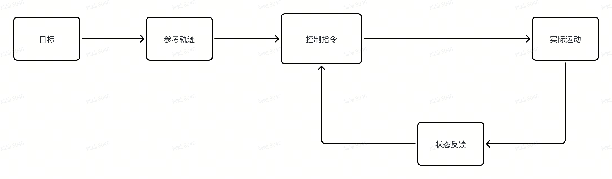
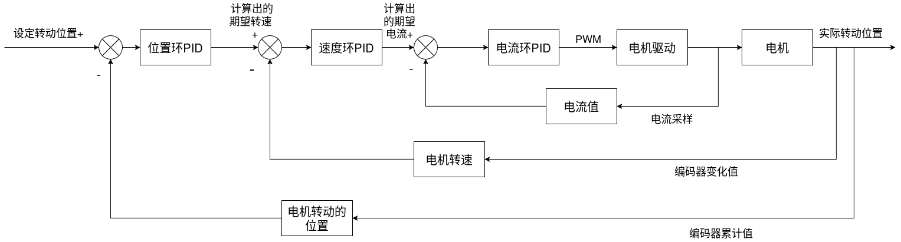
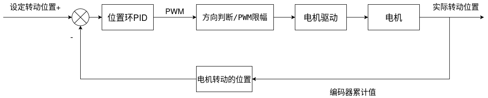
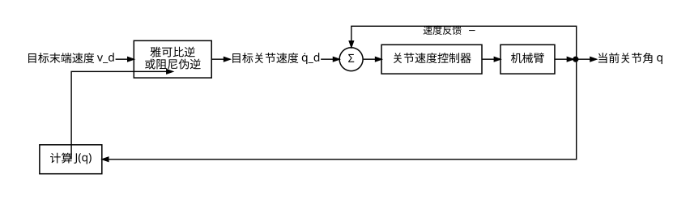

# 第六章 运动控制

> 📌 **概述**：本章把前几章得到的运动学关系与参考轨迹转化为机械臂能够执行的控制指令。首先建立“目标—规划—控制—执行—反馈”的完整链路，再介绍单关节控制、关节空间运动控制、笛卡尔位置与速度控制，最后结合 JoyArm 的规划器、控制器、运动状态机和通信后端完成关节运动实践。

> 📖 **章节边界**：本章以[第二章](chapt2_fkine.md)的正运动学、[第三章](chapt3_ikine.md)的逆运动学与连续逆解、[第四章](chapt4_jacobian.md)的雅可比矩阵以及[第五章](chapt5_trajectory.md)的时间参数化轨迹为基础，重点说明这些结果怎样进入控制链路，不再重复其详细推导与实现。质量、惯量和重力等动力学因素留到[第八章](chapt8_dyn.md)，机械臂与环境之间的作用力留到[第九章](chapt9_force.md)，拖动示教的完整任务留到[第十二章](chapt12_teleop.md)。

## 1 从运动目标到电机指令

机械臂运动不仅要确定终点，还要明确运动过程，并根据实际状态及时修正偏差。前五章主要回答“机械臂应该怎样运动”，本章重点回答“怎样让机械臂真正按照参考轨迹运动”。

### 1.1 运动控制的完整链路

机械臂从接收运动目标到产生实际运动，需要依次经过规划、控制和执行。驱动器与传感器再将实际状态返回控制器，使控制器能够持续修正运动偏差。



这条链路包含四个连续环节：

1. **给出目标**：确定机械臂最终要到达的关节角或末端位姿。
2. **生成参考**：规划器根据起点、终点和运动约束生成参考轨迹。
3. **计算指令**：控制器结合参考轨迹与实际反馈计算控制指令。
4. **执行与反馈**：驱动器带动电机运动，并返回实际位置、速度和力矩等状态。

其中，目标和参考轨迹沿链路向下传递，实际状态沿反馈通道返回控制器。由此形成“前向执行、反向反馈”的闭环结构。

### 1.2 规划与控制的分工

规划与控制解决的是两个连续但不同的问题：**规划决定机械臂应该怎样运动，控制使机械臂尽量按照规划结果运动。**

| 对比项 | 规划 | 控制 |
|:---:|:---:|:---:|
| 核心问题 | 应该怎样运动 | 怎样跟上参考轨迹 |
| 输入 | 运动目标和约束 | 参考轨迹和实际反馈 |
| 输出 | 参考位置、速度和加速度 | 位置、速度或力矩指令 |

规划器生成参考轨迹，控制器结合反馈跟踪参考轨迹。简单点到点运动可以只向驱动器发送目标位置；需要约束运动时间、速度或多关节同步关系时，则应显式规划轨迹。

### 1.3 控制周期与反馈闭环

一个完整控制周期通常包括：

1. 读取关节状态及其时间戳。
2. 判断反馈是否有效、是否超时。
3. 从规划器中采样当前参考状态。
4. 根据参考状态与实际状态计算控制指令。
5. 执行位置、速度、力矩和单周期增量检查。
6. 向关节驱动器发送指令。
7. 等待下一控制周期。

控制效果不仅取决于标称控制频率，还与实际周期、通信延迟、周期抖动、反馈时间戳和失联保护有关。如果反馈已经过期，即使数值看起来正常，也不能继续作为当前状态使用。

明确完整控制链路后，下面从直接驱动机械臂的单关节控制讲起。

## 2 单关节电机控制

机械臂的每个关节通常由一体化关节模组驱动。关节模组把电机、减速器、编码器、驱动器等部件集成在一起；部分产品还带有力矩传感器。上位机发送位置、速度或力矩指令，模组内部控制器根据传感器反馈调节电流，使关节按照指令运动。

### 2.1 关节状态与控制量

关节控制最常使用的位置、速度和力矩：

$$
q,\qquad \dot q,\qquad \tau.
$$

驱动器还可能返回电流、电机温度、MOS 温度、错误码、使能状态和当前控制模式。控制过程中需要区分：

- **目标值（target）**：控制器期望关节达到的状态。
- **测量值（ref）**：编码器或驱动器实际反馈的状态。
- **控制误差（err）**：目标值与测量值之差。

### 2.2 位置、速度与力矩控制模式

| 控制模式 | 主要指令 | 主要反馈 | 特点 | 典型用途 |
|:---:|:---:|:---:|:---:|:---:|
| 位置模式 | 目标角度 $q_d$ | 关节角度 $q$ | 使用直观，便于实现定点和轨迹跟踪 | `MoveJ`、回 Home、预设姿态 |
| 速度模式 | 目标角速度 $\dot q_d$ | 关节角速度 $\dot q$ | 便于连续调节运动方向与快慢 | 遥操作、视觉伺服 |
| 力矩模式 | 目标力矩 $\tau_d$ | 电流或关节力矩 $\tau$ | 可直接调节作用力，对模型和安全保护要求较高 | 阻尼、重力补偿、柔顺控制 |

#### 2.2.1 位置模式

位置模式输入目标角度 $q_d$，驱动器内部完成位置闭环。它最容易使用，但上位机通常不能直接决定实际输出力矩。

#### 2.2.2 速度模式

速度模式输入目标角速度 $\dot q_d$。速度指令需要持续发送，通信中断后必须及时停止，同时还要检查位置限位，防止关节持续向同一方向运动。

#### 2.2.3 力矩与 MIT 模式

典型 MIT 控制指令可以写成

$$
\tau_{\mathrm{cmd}}
=K_p(q_d-q)+K_d(\dot q_d-\dot q)+\tau_{\mathrm{ff}}.
$$

其中，$K_p$ 决定位置刚度，$K_d$ 提供速度阻尼，$\tau_{\mathrm{ff}}$ 为前馈力矩。通过改变这些参数，同一接口可以实现位置保持、阻尼、重力补偿和拖动示教。

> ⚠️ 力矩模式直接影响机械臂与环境之间的作用力。实际设备必须同时设置关节限位、速度限制、力矩限制、急停和通信超时保护。

### 2.3 串级闭环与 PID 控制

位置模式并不表示电机内部只控制位置。典型驱动器采用串级控制：位置环输出速度目标，速度环输出电流或力矩目标，最内层电流环驱动电机。越靠内的控制环，运行频率通常越高。



三个控制环从外到内逐级生成下一层的目标：

| 控制环 | 输入目标 | 主要反馈 | 输出给下一层 | 主要作用 |
|:---:|:---:|:---:|:---:|:---:|
| 位置环 | 目标角度 $q_d$ | 实际角度 $q$ | 目标角速度 $\dot q_d$ | 减小位置误差 |
| 速度环 | 目标角速度 $\dot q_d$ | 实际角速度 $\dot q$ | 目标电流或力矩 | 调节运动快慢并提供阻尼 |
| 电流环 | 目标电流 $i_d$ | 实际电流 $i$ | PWM 或电压指令 | 快速建立电磁力矩 |

因此，上位机发送目标角度后，驱动器并不是立即把电机“拉到”目标位置，而是先由位置环根据位置误差生成速度目标，再由速度环生成电流或力矩目标，最后由电流环驱动电机。负载变化或受到外部扰动时，反馈会改变各环误差，控制器随即更新后续指令。

以单关节位置控制为例，位置误差与 PID 控制律分别为

$$
e(t)=q_d(t)-q(t),
$$

$$
u(t)=K_p e(t)+K_i\int_0^t e(\xi)\,\mathrm{d}\xi+K_d\dot e(t).
$$

- **比例项（$K_p e(t)$）**根据当前误差立即修正；增益过大可能引起超调和振荡。
- **积分项（$K_i\int_0^t e(\xi)\,\mathrm{d}\xi$）**累积历史误差，可减小稳态误差，但过强时容易产生积分饱和。
- **微分项（$K_d\dot e(t)$）**反映误差变化趋势，可增加阻尼，但对测量噪声较敏感。



PID 是单个控制环根据误差计算输出的一种方法，串级控制则描述多个控制环怎样嵌套。位置环、速度环和电流环可以采用不同形式的 P、PI 或 PID 控制，并不要求三个环使用完全相同的控制律。通常先调响应最快的电流环，再调速度环，最后调位置环；如果内环尚未稳定，直接提高外环增益容易引起超调和振荡。

实际调参不能只追求响应快，还要同时观察上升时间、超调量、稳定时间、稳态误差、振荡和噪声。工程实现还需要处理输出限幅、积分饱和和微分噪声：控制量达到上限后应限制积分继续累积，微分项通常需要滤波。机械臂负载、减速器摩擦和结构柔性变化后，原有参数也可能需要调整。

### 2.4 通信、同步与失联保护

上位机需要通过通信链路向各关节发送指令并读取状态。CAN、RS-485 和 EtherCAT 位于通信体系的不同层次：CAN 定义总线通信机制，RS-485 主要定义电气接口，Modbus RTU 等协议可以运行在 RS-485 之上。

| 通信方式 | 主要特点 | 典型拓扑 | 适用场景 | 注意事项 |
|:---:|:---:|:---:|:---:|:---:|
| CAN / CAN FD | 多节点仲裁、抗干扰能力强；CAN FD 可提高数据负载和速率 | 总线型 | 移动机器人、中小型机械臂 | 终端电阻、波特率和节点 ID 必须一致 |
| RS-485 | 差分传输、布线简单，常承载 Modbus RTU 或厂商协议 | 总线型 | 低成本执行器、传感器 | 实时性取决于上层协议和轮询方式 |
| EtherCAT | 周期通信和时钟同步能力强 | 逻辑环形、物理链式 | 高性能工业运动控制 | 对主站、从站和网络配置要求较高 |

选择通信方式时，应同时考虑控制周期、节点数量、报文长度、同步精度、布线环境和开发成本。通信中断后，应停止使用旧反馈，并根据风险进入保持、阻尼或失能状态。

单关节闭环解决了一个关节怎样跟踪目标；要完成机械臂运动，还需要让多个关节按照统一的轨迹和时间基准协调执行。

## 3 关节空间运动控制

关节空间运动控制直接规定各关节随时间变化的参考状态，解决多个关节怎样按照同一时间基准协调运动，是机械臂点到点运动和预设动作最常用的方式。

### 3.1 关节目标与关节轨迹

单个目标 $\bm q_{\mathrm{goal}}$ 只规定终点；第五章生成的

$$
\bm q_d(t),\qquad \dot{\bm q}_d(t),\qquad \ddot{\bm q}_d(t)
$$

还规定中间运动过程。控制器应按固定周期采样当前参考状态，而不是一次性把相距很远的目标直接发送给电机。

### 3.2 关节位置跟踪

关节位置误差为

$$
\bm e_q=\bm q_d-\bm q.
$$

使用驱动器内部位置环时，上位机可以周期发送 $\bm q_d(t)$；由上位机计算控制量时，还可以根据位置误差和速度误差形成 PD 控制。

### 3.3 `MoveJ`

`MoveJ` 在关节空间生成并执行轨迹，使各关节从当前位置平滑运动到目标关节角：

- 各关节协调开始和到达。
- 目标需要满足关节位置、速度和加速度限制。
- 适合点到点运动、回 Home 和预设姿态。
- 末端中间路径通常不是直线。

### 3.4 Home、Zero 与 Neutral

- **Zero**：关节坐标零位，主要用于标定和坐标定义。
- **Home**：机械臂启动、停机或任务准备时使用的安全姿态。
- **Neutral**：软限位中点，不一定适合作为实际运动目标。

移动到零位与重新标定零点是两种不同操作。普通任务通常使用 `move_home()`，不应把 `move_zero()` 当作默认回位方式。

> 🖼️ **配图占位：Home、Zero 与 Neutral 位形对比**
>
> 建议并排显示同一机械臂的三种位形，并标出各位形的主要用途。建议文件名：`home_zero_neutral_comparison.svg`。

### 3.5 到位判断

指令发送完成不等于机械臂已经到位。基本位置条件为

$$
|q_i-q_{d,i}|<\varepsilon_i.
$$

工程实现还应检查反馈是否新鲜、关节速度是否已经下降、是否连续多个周期满足容差、是否超时以及是否出现故障。

## 4 笛卡尔位置运动控制

笛卡尔位置运动控制以末端位置和姿态作为输入，再通过逆运动学转换为关节目标。从系统层级看，任务层给出末端目标，整机控制层计算协调一致的关节目标，关节控制层再使各关节跟踪目标。整机控制并不替代单关节控制，而是在其外层完成目标转换。

本节说明逆运动学结果怎样进入轨迹规划和关节控制链路。

### 4.1 从末端目标到关节目标

设机械臂正运动学为

$$
\bm T=f(\bm q).
$$

对于目标位姿 $\bm T_d$，逆运动学求解满足

$$
f(\bm q_d)=\bm T_d
$$

的目标关节角。完整控制链路如下图所示：


### 4.2 逆运动学解的连续选择

候选解需要依次检查有效性、可达性、关节限位、肩肘腕构型、与当前关节角的距离，以及相邻采样点是否保持同一逆解分支。如果相邻目标选择不同分支，关节目标可能突然跳变；奇异位形附近，末端的小幅运动也可能要求关节快速变化。

### 4.3 面向末端目标的 `MoveJ`

如果只对目标末端位姿求一次逆运动学，再从当前关节角运动到终点关节角，那么该运动仍属于 `MoveJ`。它保证终点末端位姿，但不保证中间末端路径为直线。

### 4.4 `MoveL`

`MoveL` 先在笛卡尔空间对位置和姿态进行插值，再对每个采样位姿连续求逆运动学。它能够使末端沿近似直线运动，但需要额外处理连续逆解、不可达、关节限位和奇异性。姿态插值应使用旋转矩阵、四元数或旋转向量，不能直接对欧拉角逐项线性插值。

第三章实践只验证“笛卡尔几何路径 → 连续逆解 → 正运动学回代”这一运动学过程；路径的速度、加速度和到达时间等时间参数化属于第五章。只有几何路径与时间规律都确定并交由控制器执行后，才构成完整的 `MoveL`。

### 4.5 `MoveJ` 与 `MoveL` 对比

| 对比项 | `MoveJ` | `MoveL` |
|:---:|:---:|:---:|
| 规划空间 | 关节空间 | 笛卡尔空间 |
| 主要目标 | 关节平滑到达 | 末端沿指定路径运动 |
| 中间末端路径 | 通常不是直线 | 接近直线 |
| 计算复杂度 | 较低 | 较高 |
| 主要风险 | 末端路径不可预期 | 连续逆解、不可达与奇异 |
| 典型场景 | 点到点、回 Home | 插入、涂胶、直线接近 |

> 🖼️ **配图占位：`MoveJ` 与 `MoveL` 末端路径对比**
>
> 建议在同一组起点和终点之间，分别绘制 `MoveJ` 的弯曲末端路径与 `MoveL` 的直线路径，并用若干中间姿态表示运动过程。建议文件名：`movej_movel_path_comparison.svg`。

笛卡尔位置控制适合描述“末端到哪里”；对于遥操作、视觉伺服等连续跟踪任务，还需要进一步描述“末端此刻向哪里运动、运动多快”。

## 5 笛卡尔速度运动控制

笛卡尔速度运动控制直接建立末端速度与关节速度之间的关系，适合末端连续跟踪、遥操作和视觉伺服等任务。

本节使用雅可比矩阵构造速度控制关系，说明末端速度怎样转化为关节速度、怎样加入位姿误差反馈，以及关节速度最终怎样由驱动器执行。

### 5.1 雅可比速度映射

末端速度旋量 $\bm v$ 与关节速度 $\dot{\bm q}$ 满足

$$
\bm v=\bm J(\bm q)\dot{\bm q},
$$

其中，$\bm J(\bm q)$ 为雅可比矩阵。控制器需要根据当前关节角周期更新雅可比矩阵。

### 5.2 末端速度到关节速度

一般可以使用伪逆计算关节速度：

$$
\dot{\bm q}_d=\bm J^\dagger(\bm q)\bm v_d.
$$

方阵且可逆时可以使用逆矩阵；一般机械臂更常使用伪逆。冗余机械臂还可以利用零空间完成避限位或改善姿态等次要任务。



### 5.3 加入位姿误差反馈

只发送前馈速度时，模型误差、离散积分误差和外部扰动会逐渐累积。可以加入位姿误差反馈：

$$
\bm v_c=\bm v_d+\bm K_p\bm e,
$$

$$
\dot{\bm q}_d=\bm J^\dagger(\bm q)\bm v_c.
$$

位置误差可以直接相减，姿态误差应使用旋转矩阵、旋转向量或四元数计算，不能直接把欧拉角逐项相减。位置、姿态误差和目标速度还必须表达在同一参考坐标系中。

### 5.4 速度目标的执行

驱动器支持速度模式时，可以直接发送关节速度目标。如果驱动器只提供位置模式，可以离散积分得到下一周期位置：

$$
\bm q_{k+1}=\bm q_k+\dot{\bm q}_{d,k}\Delta t.
$$

实际实现必须使用真实控制周期 $\Delta t$，并限制关节速度、单周期位置增量和积分后的关节位置。

### 5.5 奇异性与阻尼伪逆

机械臂接近奇异位形时，雅可比矩阵的某些奇异值趋近于零，普通伪逆可能把很小的末端速度放大为很大的关节速度。常用的阻尼最小二乘伪逆为

$$
\bm J_{\lambda}^{\dagger}
=\bm J^{\mathsf{T}}\left(\bm J\bm J^{\mathsf{T}}+\lambda^2\bm I\right)^{-1}.
$$

阻尼越大，关节速度越平稳，但末端跟踪误差也可能增大。阻尼伪逆不能消除几何奇异性，因此仍需设置关节速度上限，并在必要时减速或停止。

### 5.6 位置控制与速度控制的关系

| 对比项 | 位置运动学控制 | 速度运动学控制 |
|:---:|:---:|:---:|
| 主要输入 | 目标末端位姿 | 目标末端速度与位姿误差 |
| 核心计算 | 逆运动学 | 雅可比逆、伪逆或阻尼伪逆 |
| 下层指令 | 关节位置 | 关节速度，或积分后的关节位置 |
| 优点 | 结构直接，适合定点与离线轨迹 | 可连续修正误差，适合在线跟踪 |
| 主要风险 | 多解、不连续、目标不可达 | 奇异处速度放大、积分漂移 |
| 典型场景 | 搬运、抓取、预设动作 | 遥操作、视觉伺服、路径跟踪 |

两类方法不是互斥关系。`MoveL` 可以通过连续逆运动学实现，也可以通过雅可比速度控制实现；即使下层电机只支持位置模式，上层仍可通过速度积分实现笛卡尔速度控制。

笛卡尔位置与速度控制把前面学过的运动学关系放回完整控制链路，并为后续遥操作、视觉伺服和力控制建立接口概念。本章实践选择最基础、最容易安全验证的关节位置控制。

以上内容介绍了机械臂运动控制的通用方法，下面将这些方法映射到 JoyArm 的规划器、控制器、状态机和通信后端。

## 6 JoyArm 中的运动控制机制

JoyArm 把目标、轨迹、控制、状态管理和硬件通信分成不同组件，使同一套运动流程能够组合不同的规划器、控制器和机械臂型号。

### 6.1 主要组成

- `TrajFrame`：保存目标或参考轨迹帧。
- `TrajPlanner`：接收目标并生成、采样轨迹。
- `Controller`：把参考轨迹帧转换为电机指令。
- `MotionFSM`：管理运动状态和本体控制权限。
- `Backend`：实现具体型号的通信与电机指令。
- `safe_monitor`：判断安全事件，由 FSM 执行对应动作。

这些组件与第 1 节通用控制链路的对应关系如下：

| 通用环节 | JoyArm 组件 | 主要职责 |
|:---:|:---:|:---:|
| 运动目标 | `TrajFrame`、目标帧通道 | 保存并发布关节目标或笛卡尔目标 |
| 轨迹规划 | `TrajPlanner` | 根据目标生成并按时刻采样参考轨迹 |
| 控制计算 | `Controller` | 结合参考帧与关节反馈生成电机指令 |
| 状态管理 | `MotionFSM` | 管理回位、运动、保持、阻尼和失能状态 |
| 安全判断 | `safe_monitor` | 检查故障、失联及自定义安全规则 |
| 执行与反馈 | `Backend` | 与具体电机通信，下发指令并读取关节状态 |

### 6.2 数据流

```text
set_target_joint / set_target_cart
              ↓
目标帧通道
              ↓
TrajPlanner.plan()
              ↓
TrajPlanner.sample()
              ↓
Controller.step()
              ↓
JoyArm 公开下发接口
              ↓
Backend
              ↓
关节电机
```

应用代码只负责设置目标。规划线程周期检查目标版本，只在收到新目标时调用规划器生成轨迹；控制线程按控制周期采样当前轨迹、读取关节反馈并执行控制器，Backend 再把统一指令转换为具体型号的通信报文。

### 6.3 规划器

JoyArm 当前提供两类单关节目标规划器：

- **直传规划器**：把目标帧中的关节参考直接提供给控制器。
- **三次多项式规划器**：根据起点、终点和到达时间生成平滑关节轨迹。

`plan_hz` 决定规划线程检查新目标的频率。写入新目标后，规划器只生成一次对应轨迹；在目标再次变化前，控制线程持续调用 `sample()` 获取当前时刻的参考帧，不会周期性重建同一条三次轨迹。目标时间 `t` 在不同规划器中的含义可能不同，使用时应以规划器契约为准。

### 6.4 控制器

- `JointPositionDirectController`：读取轨迹帧中的关节角，通过位置模式下发。
- `JointDragTeachController`：使用 MIT 模式、重力补偿、阻尼和缓释平衡点实现拖动示教。

第六章实践主要使用位置控制器。

### 6.5 MotionFSM 状态

- `DISABLE`：机械臂失能。
- `ZERO`：回到零位并失能。
- `HOME`：运动到 Home 位形。
- `MOTION`：正常执行规划和控制。
- `HOLD`：保持当前位置。
- `DAMP`：进入阻尼保护。

FSM 运行后，本体运动指令由控制线程统一下发，外部直接发送本体电机指令会被拦截。`DAMP` 使用阻尼和可选的部分重力补偿降低运动风险，但它不等同于完整拖动示教。

### 6.6 高级运动接口与底层目标通道

当前底层运动方式为：

```python
arm.set_target_joint(t, q)
arm.is_in_q_arm(q)
```

面向普通任务可以进一步封装为：

```python
arm.move_j(q, duration=2.0, wait=True)
arm.move_home(wait=True)
```

高级接口负责目标校验、等待到位和超时处理，底层仍复用目标帧、规划器、控制器与 FSM，不应重新建立另一套运动机制。

明确各软件组件及其数据流后，下面通过关节运动实验验证目标、规划、控制、执行和反馈组成的完整链路。

## 7 本章实践：JoyArm 关节运动控制

本章实践使用 JoyArm 已有的三次关节轨迹规划器、关节位置控制器和 MotionFSM，依次完成单关节小幅运动与多关节 `MoveJ`。脚本记录目标终点、实际关节位置、实际关节速度、终点剩余误差、反馈帧龄和状态机状态，并自动生成 CSV 与关节曲线图。

实践重点是验证“目标—规划—控制—执行—反馈”怎样在 JoyArm 中形成完整运行链路。

### 7.1 实验任务

1. 选择 `single_joint_cubic_traj_planner` 三次轨迹规划器。
2. 选择 `joint_position_direct_controller` 关节位置控制器。
3. 连接机械臂，等待新鲜反馈并检查两组小幅目标。
4. 启动 MotionFSM，等待状态迁移至 `MOTION`。
5. 从 Home 出发，执行单关节运动并返回 Home。
6. 从 Home 出发，执行多关节 `MoveJ` 并再次返回 Home。
7. 停止监视器和 MotionFSM，完成回零、失能与断连。
8. 保存原始数据和曲线图，分析到位误差、速度峰值、反馈帧龄与采样周期。

### 7.2 运行方法

先同步项目环境：

```bash
cd joyarm_code
uv sync
```

连接机械臂并运行实践脚本：

```bash
uv run python chapt/chapt6/chapt6_control_demo.py rebot_arm_b601_dm
```

默认每段运动时间为 3 s，记录频率为 50 Hz，结果保存在当前目录。可以通过参数修改：

```bash
uv run python chapt/chapt6/chapt6_control_demo.py rebot_arm_b601_dm \
    --duration 4.0 \
    --sample-hz 50 \
    --output-dir results
```

| 参数 | 含义 | 默认值 |
|:---:|:---:|:---:|
| `model` | 机械臂型号 | 必填 |
| `--duration` | 每段运动的规划时间 | `3.0` s |
| `--sample-hz` | 教学数据记录频率 | `50` Hz |
| `--output-dir` | CSV 和图片保存目录 | 当前目录 |

> ⚠️ `--sample-hz` 是主线程记录数据的频率，不是控制器的实际运行频率。规划器和控制器分别按照型号配置中的 `plan_hz` 与 `ctrl_hz` 运行。

### 7.3 目标生成与运动流程

脚本以 Home 为共同起点。单关节实验只改变一个关节：

$$
q_{\mathrm{goal},i}=q_{\mathrm{home},i}+\Delta q_i,
$$

其余关节保持 Home 角度。多关节实验同时改变若干关节，并由同一个目标到达时刻约束各关节协调运动。每个偏移量根据 Home 到软限位两侧的可用空间自动选择，单关节最大偏移不超过 $0.15\ \mathrm{rad}$。

每段运动只向目标通道写入一帧终点与绝对到达时刻。规划线程检测到目标版本变化后生成一次三次参考轨迹，控制线程周期采样这条轨迹并通过位置控制器下发；主线程只负责读取反馈和记录数据，不直接向电机发送位置指令。

启动时应观察状态机按以下路径进入正常运动状态：

```text
DISABLE → HOME → MOTION
```

实验结束后，脚本停止监视器和 MotionFSM，由状态机完成安全收尾。

### 7.4 数据与输出文件

CSV 文件名为 `chapt6_joint_control_<时间戳>.csv`，每一行对应一帧教学采样数据：

| 数据 | 含义 |
|:---:|:---:|
| `t_s`、`phase` | 实验相对时间和当前运动阶段 |
| `q_goal_*` | 当前阶段的目标终点关节角 |
| `q_*`、`dq_*` | 实际反馈关节角和关节速度 |
| `endpoint_error_*` | 目标终点与实际位置之差，即终点剩余误差 |
| `frame_age_ms` | 记录时刻与反馈时间戳之差 |
| `motion_state` | MotionFSM 当前状态 |
| `safety_event` | 当前安全事件 |

PNG 文件名为 `chapt6_joint_control_<时间戳>.png`。每个关节单独占一个子图，蓝色实线表示实际位置反馈，橙色虚线表示当前阶段的目标终点，竖直虚线表示运动阶段切换。

当前公开 API 不提供规划器每个控制周期的内部参考帧，因此图中的橙色虚线不是三次参考轨迹。它只表示本阶段最终要到达的关节角；实际反馈曲线是否平滑，可以用于观察整个规划与控制链路的综合效果，但不能单独分离规划误差和控制跟踪误差。

### 7.5 验收指标

| 验收项 | 判断依据 |
|:---:|:---:|
| 目标有效 | 自动生成的目标位于软限位内且不含非有限值 |
| 状态机就绪 | 15 s 内进入 `MOTION` 状态 |
| 反馈有效 | 状态持续更新，反馈维度正确，帧龄无异常增大 |
| 到位完成 | 规划时间结束后，连续 5 个记录点满足 `is_in_q_arm()` |
| 运动连续 | 实际位置曲线连续，速度无无法解释的尖峰或持续振荡 |
| 安全停止 | 实验结束后 MotionFSM 完成停止、回零和失能流程 |

脚本按阶段打印最大终点剩余误差、末帧终点剩余误差、最大反馈速度和采样帧数，同时打印记录周期的均值、标准差以及最大反馈帧龄。最大终点剩余误差通常出现在运动开始时，不能作为控制器跟踪误差；判断到位质量时应重点观察末帧终点剩余误差。严格的轨迹跟踪误差应由规划器瞬时参考值与实际反馈之差计算。

### 7.6 结果分析

结果分析按照“位置—速度—时序—状态”的顺序进行：

1. **检查最终位置**：实际反馈应在运动结束后进入目标容差，并保持稳定。
2. **检查运动连续性**：位置曲线不应出现不连续跳变，速度曲线不应出现反复的大幅正负切换。
3. **比较单关节与多关节运动**：多关节应从同一时段开始变化，并在接近的时刻进入目标容差。
4. **检查反馈时序**：若最大帧龄持续增大，先排查通信和状态刷新，不继续解释控制效果。
5. **检查状态机**：正常采样阶段应保持 `MOTION` 和 `NORMAL`；出现其他状态或事件时，应结合日志查明触发原因。

> 🖼️ **实验结果占位：目标终点与六关节位置反馈曲线**
>
> 真机实验完成后，从脚本生成的图片中选择一张代表性结果放在此处，并在图下说明运动时长、末帧误差、最大反馈速度和最大反馈帧龄。建议文件名：`joint_control_experiment_result.png`。

常见现象及排查方向如下：

| 现象 | 优先检查 |
|:---:|:---:|
| 位置曲线在起步时突然跳变 | 是否误用了直传规划器、目标时间是否已经过期 |
| 到达目标后持续振荡 | 位置环增益、速度环阻尼、负载和结构柔性 |
| 多关节到达时间差异明显 | 目标时间、规划器是否统一、个别关节是否触发限速 |
| 实际速度出现孤立尖峰 | 反馈差分、通信丢帧、时间戳和机械传动冲击 |
| 到位判断反复变化 | 容差是否过小、反馈噪声、关节是否仍在低速运动 |
| 反馈帧龄突然增大 | 总线负载、状态刷新线程、串口或 CAN 通信 |

### 7.7 安全边界

脚本只执行软限位内的小幅关节运动，并在启动前要求人工输入 `yes`。这不能替代急停、硬限位和现场监护。首次运行应使用空载机械臂，降低运动速度，确保机械臂周围无人且路径无遮挡；如果出现异常噪声、剧烈振荡、通信中断或错误码，应立即急停或断电，不应为了获得完整曲线继续实验。

配套脚本：`joyarm_code/chapt/chapt6/chapt6_control_demo.py`。
